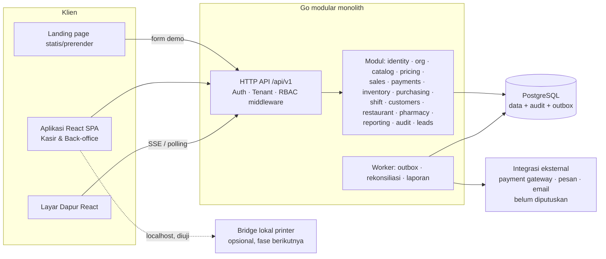

# PRD — StorePOS

- Status dokumen: Draft v0.1 untuk review lintas tim (Produk, Desain, Backend, Frontend, QA)
- Nama produk: belum ditentukan, menggunakan placeholder "[Nama POS]"
- Stack wajib: Backend Golang, Frontend React JS, Database PostgreSQL

Label yang digunakan di seluruh dokumen:

| Label | Arti |
| --- | --- |
| [KP] | Kebutuhan pengguna. Berasal langsung dari brief. |
| [REK] | Rekomendasi tim produk/arsitektur. Dapat diubah. |
| [ASM] | Asumsi kerja. Dipakai sampai ada konfirmasi. |
| [TBK] | Belum dikonfirmasi. Butuh keputusan pemilik produk/bisnis. |
| [VAL] | Wajib divalidasi oleh ahli: pajak, farmasi/regulasi, hukum/perlindungan data, atau uji perangkat. |
| (usulan) | Angka target yang belum disepakati. |

## Daftar Isi

- [1. Ringkasan dan Positioning Produk](#1-ringkasan-dan-positioning-produk)
- [2. Masalah, Tujuan, dan Metrik Keberhasilan](#2-masalah-tujuan-dan-metrik-keberhasilan)
- [3. Persona dan Segmentasi Usaha](#3-persona-dan-segmentasi-usaha)
- [4. Asumsi dan Keputusan Terbuka](#4-asumsi-dan-keputusan-terbuka)
- [5. Strategi Inti POS dan Modul Usaha](#5-strategi-inti-pos-dan-modul-usaha)
- [6. Cakupan MVP, Tahapan Lanjutan, dan Batas Dukungan](#6-cakupan-mvp-tahapan-lanjutan-dan-batas-dukungan)
- [7. Peran dan Matriks Hak Akses](#7-peran-dan-matriks-hak-akses)
- [8. Alur Pengguna Utama](#8-alur-pengguna-utama)
- [9. Kebutuhan Fungsional Inti POS](#9-kebutuhan-fungsional-inti-pos)
- [10. Kebutuhan Modul Retail](#10-kebutuhan-modul-retail)
- [11. Kebutuhan Modul Restoran](#11-kebutuhan-modul-restoran)
- [12. Kebutuhan Modul Apotek](#12-kebutuhan-modul-apotek)
- [13. Aturan Transaksi, Pembayaran, Stok, dan Pelaporan](#13-aturan-transaksi-pembayaran-stok-dan-pelaporan)
- [14. Kebutuhan Nonfungsional](#14-kebutuhan-nonfungsional)
- [15. Struktur Data Konseptual](#15-struktur-data-konseptual)
- [16. Arsitektur Golang, React JS, dan PostgreSQL](#16-arsitektur-golang-react-js-dan-postgresql)
- [17. Kebutuhan Integrasi dan Perangkat](#17-kebutuhan-integrasi-dan-perangkat)
- [18. Halaman Aplikasi dan Arahan UX](#18-halaman-aplikasi-dan-arahan-ux)
- [19. Landing Page: Strategi Marketing, Copy, dan Desain](#19-landing-page-strategi-marketing-copy-dan-desain)
- [20. Edge Cases dan Penanganan Kegagalan](#20-edge-cases-dan-penanganan-kegagalan)
- [21. Risiko, Dependensi, dan Validasi Regulasi](#21-risiko-dependensi-dan-validasi-regulasi)
- [22. Roadmap dan Kriteria Kesiapan Rilis](#22-roadmap-dan-kriteria-kesiapan-rilis)
- [23. Pertanyaan Terbuka](#23-pertanyaan-terbuka)

## 1. Ringkasan dan Positioning Produk

### 1.1 Ringkasan

[Nama POS] adalah aplikasi Point of Sale berbasis web dengan model SaaS multi-tenant untuk usaha di Indonesia. Produk ini terdiri atas satu inti POS bersama dan modul usaha yang aktif sesuai jenis bisnis:

- Inti POS: produk, transaksi, pembayaran, shift kas, stok, retur, laporan, pengguna, dan audit.
- Modul Retail: varian, konversi satuan beli/jual, kuantitas pecahan, label barcode, dan stok minimum.
- Modul Restoran/Kafe: jenis pesanan, meja, pesanan terbuka, modifier, layar dapur, dan service charge.
- Modul Apotek: satuan kemasan, batch dan tanggal kedaluwarsa, FEFO, referensi resep, serta penelusuran batch.

Aplikasi kasir dibangun sebagai aplikasi web React yang dioptimalkan untuk desktop dan tablet. Backend dibangun sebagai modular monolith Golang dengan PostgreSQL sebagai sumber data tunggal. Transaksi online menjadi baseline MVP [KP].

### 1.2 Positioning utama [REK]

Untuk pemilik toko, kafe/restoran, dan apotek di Indonesia yang masih merekap penjualan, stok, dan kas secara terpisah, [Nama POS] adalah POS berbasis web yang menyatukan transaksi kasir, pergerakan stok, dan tutup shift dalam satu catatan yang dapat ditelusuri. Berbeda dengan aplikasi kasir yang memaksakan satu alur untuk semua usaha, setiap jenis usaha mendapatkan alur kerja sendiri: pesanan terbuka dan layar dapur untuk restoran, serta batch dan tanggal kedaluwarsa untuk apotek.

Bukti yang dapat ditunjukkan pada demo produk:

- Satu penjualan menghasilkan entri kartu stok dan masuk ke ringkasan shift.
- Tutup shift menampilkan kas yang diharapkan, kas yang dihitung, dan selisihnya.
- Alur restoran dan apotek memiliki layar yang berbeda dari alur retail.

### 1.3 Prinsip produk [REK]

- Kasir dulu. Setiap keputusan UX di layar kasir diukur dari kecepatan dan jumlah kesalahan.
- Satu definisi angka. Transaksi, stok, dan laporan memakai definisi tunggal di §13.
- Histori tidak berubah. Koreksi dilakukan melalui dokumen baru, seperti void, retur, atau penyesuaian. Data lama tidak diedit.
- Jujur tentang batas dukungan. Fitur, perangkat, dan regulasi yang belum tervalidasi tidak dipasarkan.

## 2. Masalah, Tujuan, dan Metrik Keberhasilan

### 2.1 Masalah [KP]

| Masalah | Dampak |
| --- | --- |
| Transaksi kasir lambat: harga dicari manual dan total dihitung ulang | Antrean panjang dan salah hitung |
| Stok tidak akurat: penjualan dan penerimaan barang tidak tercatat di satu tempat | Kehabisan barang, kelebihan stok, atau barang kedaluwarsa (apotek) |
| Tutup kas membingungkan: kas masuk/keluar tidak tercatat | Selisih kas tanpa penjelasan |
| Laporan terpisah: penjualan, pengeluaran, dan stok berada di buku/spreadsheet berbeda | Pemilik sulit menilai performa usaha |
| Aplikasi generik tidak cocok untuk restoran/apotek | Pengguna membuat cara kerja di luar sistem |

### 2.2 Tujuan produk [KP]

- G1: Mempercepat transaksi kasir.
- G2: Mengelola produk, stok, dan operasional usaha.
- G3: Memberi pemilik gambaran penjualan, pengeluaran operasional, dan performa usaha.
- G4: Mengakomodasi alur berbeda melalui modul per jenis usaha.
- G5: Menyediakan pengalaman kasir yang mudah dipelajari di desktop dan tablet.

### 2.3 Metrik keberhasilan (semua usulan)

| ID | Metrik | Target (usulan) | Cara ukur |
| --- | --- | --- | --- |
| M1 | Median waktu transaksi retail 5 item via scanner, pembayaran tunai | ≤ 25 detik | Uji usabilitas + event sale_started → sale_completed |
| M2 | Waktu dari daftar sampai transaksi pertama | ≤ 30 menit (median) | Event onboarding |
| M3 | Kasir baru menyelesaikan transaksi tanpa bantuan | ≥ 80% peserta uji pada percobaan pertama | Uji usabilitas |
| M4 | Shift yang ditutup lewat sistem | ≥ 90% shift yang dibuka | Data shift |
| M5 | Cabang aktif mingguan (≥1 transaksi/hari selama 5 hari) | Baseline ditetapkan setelah pilot | Data transaksi |
| M6 | Tingkat kesalahan finalisasi transaksi (server error) | < 0,1% dari percobaan | Observability |
| M7 | Konversi pengunjung landing page → permintaan demo | Baseline ditetapkan 4 minggu pertama | Analytics |
| M8 | Insiden kebocoran data lintas tenant | 0 | Uji keamanan + audit |

## 3. Persona dan Segmentasi Usaha

Persona berikut bersifat ilustratif [ASM] dan perlu divalidasi lewat wawancara pengguna.

| Persona | Peran | Kebutuhan utama | Frustrasi |
| --- | --- | --- | --- |
| Pemilik toko kelontong/minimarket kecil | Pemilik, kadang kasir | Scan cepat, stok tidak minus diam-diam, tutup kas jelas | Rekap di buku dan WhatsApp |
| Pemilik toko pakaian | Pemilik/Manajer | Varian ukuran/warna, label barcode, retur tukar ukuran | Stok per ukuran tidak terlacak |
| Kasir | Kasir | Layar sederhana, tombol besar, sedikit langkah | Takut salah input dan selisih kas |
| Staf gudang | Gudang | Terima barang, opname | Selisih stok tanpa jejak |
| Pemilik kafe | Pemilik/Manajer | Pesanan terbuka, modifier, dapur tahu urutan | Pesanan tercecer, kertas order hilang |
| Staf dapur/bar | Dapur | Antrean pesanan jelas, status siap | Pesanan dibatalkan tanpa info |
| Apoteker penanggung jawab | Apoteker | Batch dan ED, FEFO, pencatatan resep, penelusuran | Obat kedaluwarsa terjual, sulit menelusuri batch |
| Admin platform | Internal | Dukungan pelanggan dengan akses terbatas | Akses berlebih berisiko |

Segmentasi dan kesiapan [REK]:

| Segmen | Kompleksitas | Rekomendasi peluncuran |
| --- | --- | --- |
| Retail kecil (1–3 kasir, 1 cabang) | Rendah–sedang | Target utama MVP |
| Restoran/kafe kecil (tanpa split bill dan printer dapur langsung) | Sedang | Diluncurkan dengan batasan yang dinyatakan |
| Apotek | Tinggi + regulasi | Pilot terbatas setelah validasi [VAL] |
| Multi-cabang operasional (transfer stok, harga per cabang) | Tinggi | Fase berikutnya |

## 4. Asumsi dan Keputusan Terbuka

### 4.1 Asumsi

| ID | Asumsi |
| --- | --- |
| ASM-01 | Model SaaS multi-tenant. Satu tenant = satu bisnis. [KP] |
| ASM-02 | Mata uang tunggal Rupiah (IDR) dan bahasa antarmuka Bahasa Indonesia. |
| ASM-03 | Zona waktu disimpan per cabang (WIB/WITA/WIT). Tanggal bisnis laporan mengikuti zona cabang. |
| ASM-04 | MVP membutuhkan koneksi internet untuk finalisasi transaksi. [KP] |
| ASM-05 | Barcode scanner yang didukung adalah scanner mode keyboard (HID) yang mengetik kode lalu Enter. [VAL] uji perangkat. |
| ASM-06 | Pencetakan struk MVP melalui dialog cetak browser. [REK] |
| ASM-07 | Satu pengguna memiliki satu peran per keanggotaan bisnis. Peran berlaku untuk cabang yang ditugaskan. Peran kustom masuk fase berikutnya. |
| ASM-08 | Harga jual berlaku di tingkat bisnis (sama untuk semua cabang) pada MVP. |
| ASM-09 | HPP memakai rata-rata tertimbang bergerak (moving average) per varian per cabang. Hasilnya diberi label "estimasi". [TBK] |
| ASM-10 | Pajak dan service charge dikonfigurasi pengguna. Sistem tidak menentukan tarif. [VAL] |
| ASM-11 | Browser yang didukung untuk aplikasi: Chrome dan Edge versi terbaru di Windows/ChromeOS, Chrome di Android tablet, serta Safari di iPadOS. Daftar final ditentukan setelah uji. [VAL] |

### 4.2 Keputusan terbuka (ringkas; detail di §23)

| ID | Keputusan | Dampak |
| --- | --- | --- |
| TBK-01 | Paket langganan, harga, dan masa uji coba | Copy landing page, billing, CTA |
| TBK-02 | Payment gateway untuk QRIS/kartu terintegrasi | CORE-020, rekonsiliasi |
| TBK-03 | Bridge lokal untuk printer thermal/laci kas | Biaya dan jadwal, dukungan perangkat |
| TBK-04 | Izin stok negatif untuk retail (default) | Akurasi stok vs kelancaran kasir |
| TBK-05 | Kebijakan pembulatan total tunai | Rumus total, laporan |
| TBK-06 | Penomoran struk wajib tanpa celah atau tidak | Desain counter, [VAL] pajak |
| TBK-07 | Ruang lingkup pilot apotek dan validator regulasi | Jadwal modul apotek |
| TBK-08 | Lokasi penyimpanan data (di Indonesia atau tidak) | Pilihan penyedia infrastruktur, [VAL] hukum |
| TBK-09 | Apakah pindah meja/split bill wajib sebelum restoran dipasarkan | Cakupan MVP restoran |
| TBK-10 | Kanal notifikasi lead dan CRM | Alur demo |

## 5. Strategi Inti POS dan Modul Usaha

### 5.1 Prinsip modularitas [REK]

- Inti POS memiliki satu model transaksi, satu model pembayaran, satu ledger stok, satu shift kas, dan satu mesin perhitungan harga.

Modul usaha menambah perilaku melalui:

- atribut tambahan pada produk, seperti modifier untuk restoran dan batch/ED untuk apotek;
- langkah tambahan pada alur, seperti kirim ke dapur atau verifikasi resep;
- layar khusus, seperti denah meja, layar dapur, dan peringatan ED;
- aturan validasi tambahan di backend, seperti blokir batch kedaluwarsa.

Modul tidak mengubah definisi inti. Contohnya, pesanan restoran tetap berupa sales_transaction dengan order_type dan status pesanan terbuka. Pesanan restoran tidak dibuat sebagai entitas penjualan baru.

Aktivasi modul disimpan per tenant (enabled_modules). Backend memvalidasi bahwa modul aktif sebelum menerima permintaan ke endpoint modul.

Istilah antarmuka menyesuaikan modul melalui kamus istilah. Contohnya, "Produk" ditampilkan sebagai "Menu" di restoran dan "Obat/Produk" di apotek. Nama entitas di backend tidak berubah.

### 5.2 Perbedaan alur yang tidak boleh dipaksakan

| Aspek | Retail | Restoran/Kafe | Apotek |
| --- | --- | --- | --- |
| Awal transaksi | Scan/cari → bayar langsung | Buka pesanan (meja/takeaway) → tambah item bertahap | Scan/cari → alokasi batch → (verifikasi resep) → bayar |
| Durasi transaksi | Detik–menit | Menit–jam (pesanan terbuka) | Menit |
| Stok | Varian, satuan, pecahan | Umumnya tidak dilacak per menu; resep di fase berikutnya | Per batch dan ED, FEFO |
| Langkah tambahan | Tidak ada | Kirim ke dapur, status dapur | Verifikasi oleh peran berwenang |
| Retur | Kembali ke stok jika layak | Jarang; pembatalan item lebih umum | Default ke karantina, bukan langsung ke stok jual |

### 5.3 Pemilihan jenis usaha

- Saat onboarding pengguna memilih satu jenis usaha utama: Retail, Restoran/Kafe, atau Apotek.
- Pilihan ini mengaktifkan modul dan istilah default.
- Kombinasi modul, misalnya kafe dengan rak retail, masuk fase berikutnya [REK]. Pada MVP, jenis usaha dapat diubah oleh Pemilik hanya sebelum transaksi pertama terfinalisasi. Ini mencegah data stok/batch yang tidak konsisten.

## 6. Cakupan MVP, Tahapan Lanjutan, dan Batas Dukungan

### 6.1 Matriks cakupan

| Area | MVP | Fase berikutnya | Di luar cakupan |
| --- | --- | --- | --- |
| Onboarding, cabang, pengguna | Bisnis, 1+ cabang (data), peran tetap, akses per cabang | Peran kustom, ganti pengguna cepat di terminal bersama | SSO perusahaan |
| Produk | Kategori, SKU, barcode multi, satuan + konversi, varian, impor CSV, arsip | Harga per cabang, harga bertingkat/grosir, bundel | Sinkronisasi marketplace |
| Kasir | Cari/scan, keranjang, diskon, pajak/biaya, multi-metode bayar, struk browser, struk digital (tautan) | Kirim struk via WhatsApp/email, tampilan pelanggan | — |
| Pembayaran | Tunai, nontunai dicatat manual (QRIS/kartu/transfer) | QRIS/EDC terintegrasi dengan konfirmasi otomatis | Pemrosesan kartu langsung oleh [Nama POS] |
| Shift | Buka, kas masuk/keluar, tutup dengan hitung buta, selisih | Laci kas otomatis via bridge | — |
| Koreksi | Batal draft, void dalam shift, retur + refund | Tukar barang sebagai satu dokumen | — |
| Stok | Penerimaan, penyesuaian, opname, kartu stok, stok minimum | Transfer antar cabang, PO lengkap dengan persetujuan | Peramalan permintaan |
| Supplier & pembelian | Supplier, penerimaan barang dengan supplier | PO, hutang supplier | Akuntansi hutang lengkap |
| Pelanggan | Opsional, data minimal | Loyalitas/poin, piutang | CRM marketing |
| Pengeluaran | Catat pengeluaran operasional sederhana | Kategori anggaran | Akuntansi buku besar |
| Laporan | Penjualan, pembayaran, retur, diskon, stok, produk, estimasi laba kotor, ekspor CSV | Dashboard multi-cabang lanjutan | Laporan pajak resmi |
| Restoran | Jenis pesanan, meja, pesanan terbuka, modifier, layar dapur, tiket dapur via browser, pembatalan item, service charge | Split bill, gabung pesanan, pindah meja, printer dapur langsung, resep/BOM | Integrasi platform delivery |
| Apotek | Data obat, satuan kemasan, batch/ED, FEFO, blokir ED, peringatan ED, referensi resep, retur karantina, penelusuran batch | Laporan khusus regulasi [VAL] | Diagnosis, rekomendasi terapi/dosis, integrasi e-resep |
| Offline | Indikator status koneksi, draft tidak hilang | Mode offline terbatas (lihat §17.5) | Offline penuh tanpa batas waktu |
| Platform | Admin platform dengan akses dukungan teraudit | Billing langganan otomatis | — |

### 6.2 Fitur wajib sebelum dipasarkan per segmen [REK]

| Segmen | Wajib siap | Batasan peluncuran yang harus dinyatakan |
| --- | --- | --- |
| Retail | Seluruh inti POS MVP + RTL-001 s.d. RTL-006 | Belum ada harga grosir/bertingkat, belum ada barcode timbangan, cetak via browser |
| Restoran/Kafe | Inti POS + RST-001 s.d. RST-010, RST-013 | Belum ada split bill/gabung/pindah meja; tiket dapur via browser atau layar dapur; stok bahan baku belum otomatis |
| Apotek | Inti POS + APT-001 s.d. APT-012 dan lulus validasi apoteker/regulasi | Dipasarkan sebagai "pilot terbatas"; laporan khusus regulasi belum tersedia; tidak mengklaim kepatuhan |

Kalimat batas dukungan resmi (dipakai di landing page dan penjualan):

- "[Nama POS] dirancang untuk toko retail, kafe/restoran, dan apotek skala kecil hingga menengah dengan koneksi internet. Fitur yang belum tersedia dicantumkan di setiap halaman jenis usaha."

## 7. Peran dan Matriks Hak Akses

### 7.1 Prinsip

- Otorisasi ditegakkan di backend pada setiap request, berdasarkan tenant, keanggotaan, peran, dan cabang. Penyembunyian menu di frontend hanya untuk kenyamanan [KP].
- Otorisasi atasan (override): tindakan bertanda O dapat dilakukan kasir jika Manajer/Pemilik memasukkan PIN otorisasi di perangkat yang sama. Log mencatat pelaku dan pemberi otorisasi.
- Peran Apoteker/Staf berwenang mencakup seluruh izin Kasir plus izin farmasi.
- Admin platform tidak memiliki akses ke data tenant secara default (lihat CORE-045).

### 7.2 Matriks

Legenda: ✓ = boleh (di cabang yang ditugaskan; Pemilik = semua cabang) · O = dengan otorisasi atasan · L = lihat saja · ✗ = tidak boleh · S = hanya lewat sesi dukungan yang disetujui

| Tindakan | Pemilik | Manajer | Kasir | Gudang | Dapur | Apoteker/Berwenang | Admin Platform |
| --- | --- | --- | --- | --- | --- | --- | --- |
| Pengaturan bisnis, modul, langganan | ✓ | ✗ | ✗ | ✗ | ✗ | ✗ | S (L) |
| Kelola cabang & terminal | ✓ | L | ✗ | ✗ | ✗ | ✗ | S (L) |
| Kelola pengguna & penugasan | ✓ | ✓ (kecuali Pemilik/Manajer) | ✗ | ✗ | ✗ | ✗ | ✗ |
| Kelola produk, harga, pajak/biaya | ✓ | ✓ | L | L (tanpa harga beli) | L (menu) | ✓ (data obat) | S (L) |
| Lihat harga beli & HPP | ✓ | ✓ | ✗ | ✓ | ✗ | ✓ | ✗ |
| Membuat transaksi penjualan | ✓ | ✓ | ✓ | ✗ | ✗ | ✓ | ✗ |
| Diskon ≤ batas peran | ✓ | ✓ | ✓ | ✗ | ✗ | ✓ | ✗ |
| Diskon > batas / ubah harga di keranjang | ✓ | ✓ | O | ✗ | ✗ | O | ✗ |
| Void transaksi | ✓ | ✓ | O | ✗ | ✗ | O | ✗ |
| Retur & refund | ✓ | ✓ | O | ✗ | ✗ | O | ✗ |
| Buka/tutup shift sendiri, kas masuk/keluar | ✓ | ✓ | ✓ | ✗ | ✗ | ✓ | ✗ |
| Lihat selisih kas semua shift | ✓ | ✓ | ✗ (hanya shift sendiri setelah tutup) | ✗ | ✗ | ✗ | ✗ |
| Penerimaan barang | ✓ | ✓ | ✗ | ✓ | ✗ | ✓ | ✗ |
| Penyesuaian stok | ✓ | ✓ | ✗ | O | ✗ | O | ✗ |
| Stok opname: input hitungan | ✓ | ✓ | ✗ | ✓ | ✗ | ✓ | ✗ |
| Stok opname: posting hasil | ✓ | ✓ | ✗ | ✗ | ✗ | ✗ | ✗ |
| Supplier | ✓ | ✓ | ✗ | ✓ | ✗ | ✓ | ✗ |
| Catat pengeluaran operasional | ✓ | ✓ | O (kas keluar) | ✗ | ✗ | ✗ | ✗ |
| Laporan penjualan & pembayaran | ✓ | ✓ | ✗ | ✗ | ✗ | L (cabang) | ✗ |
| Laporan estimasi laba kotor | ✓ | ✗ [TBK] | ✗ | ✗ | ✗ | ✗ | ✗ |
| Layar dapur: ubah status item | ✓ | ✓ | ✗ | ✗ | ✓ | — | ✗ |
| Kelola meja | ✓ | ✓ | L + pakai | ✗ | ✗ | — | ✗ |
| Batalkan item yang sudah dikirim ke dapur | ✓ | ✓ | O | ✗ | ✗ | — | ✗ |
| Kelola batch & ED | ✓ | L | ✗ | ✓ | — | ✓ | ✗ |
| Verifikasi penjualan produk wajib-resep | ✗ [TBK][VAL] | ✗ | ✗ | ✗ | — | ✓ | ✗ |
| Putuskan retur obat kembali ke stok jual | ✗ [VAL] | ✗ | ✗ | ✗ | — | ✓ | ✗ |
| Lihat audit log | ✓ | L (cabang) | ✗ | ✗ | ✗ | ✗ | S |
| Akses data tenant | ✓ | sesuai di atas | sesuai di atas | sesuai di atas | sesuai di atas | sesuai di atas | S (baca saja, terbatas waktu) |

Catatan: apakah Pemilik yang bukan apoteker boleh memverifikasi penjualan produk wajib-resep harus diputuskan bersama validator farmasi [VAL].

## 8. Alur Pengguna Utama

### 8.1 Onboarding

1. Daftar (nama, email/no. HP, kata sandi) → verifikasi email/OTP [TBK kanal OTP].
2. Isi nama bisnis → pilih jenis usaha → isi cabang pertama (nama, alamat, zona waktu).
3. Konfigurasi awal sesuai jenis usaha:
   - pajak (aktif/tidak, nama, tarif, inklusif/eksklusif);
   - service charge (restoran);
   - pembulatan tunai;
   - header/footer struk.
4. Tambah produk: manual, impor CSV, atau contoh data demo yang dapat dihapus.
5. Undang pengguna (opsional) → buka shift → transaksi uji.
6. Checklist onboarding menampilkan progres.

### 8.2 Penjualan retail

1. Kasir login → pilih cabang & terminal → buka shift (input kas awal).
2. Scan barcode atau cari → item masuk keranjang (scan ulang menambah kuantitas).
3. Ubah kuantitas/satuan, beri diskon (O bila melebihi batas), tambah catatan.
4. Klik Bayar → pilih metode (bisa lebih dari satu) → input nominal tunai → sistem hitung kembalian.
5. Finalisasi → stok berkurang → struk ditampilkan/dicetak → keranjang baru.

### 8.3 Dine-in restoran

1. Pilih meja kosong (atau Takeaway/Delivery) → pesanan terbuka dibuat, meja menjadi "Terisi".
2. Tambah menu + modifier → Kirim ke Dapur → tiket muncul di layar dapur/tercetak.
3. Dapur ubah status item: Diproses → Siap. Pelayan menandai Disajikan.
4. Tambah pesanan susulan → kirim lagi sebagai tiket baru.
5. Pelanggan minta tagihan → cetak tagihan sementara (bukan struk lunas).
6. Bayar → transaksi final. Meja menjadi "Perlu Dibersihkan" lalu "Kosong" setelah ditandai.

### 8.4 Penjualan apotek

1. Scan/cari obat → pilih satuan (misal strip) → sistem alokasikan batch FEFO yang belum kedaluwarsa dan menampilkan nomor batch + ED.
2. Jika produk ditandai wajib referensi resep: input data referensi resep. Pengguna berperan Apoteker/Berwenang memverifikasi; kasir tanpa peran tersebut meminta otorisasi.
3. Bayar → finalisasi → stok batch berkurang → struk mencantumkan batch/ED [TBK apakah dicetak].

### 8.5 Tutup shift

1. Kasir klik Tutup Shift → input jumlah kas yang dihitung (hitung buta: kas yang diharapkan belum ditampilkan).
2. Sistem menampilkan kas diharapkan, kas dihitung, dan selisih.
3. Jika selisih melebihi ambang, kasir wajib mengisi catatan dan Manajer memberi otorisasi.
4. Laporan shift dapat dicetak.

### 8.6 Retur

1. Cari transaksi (nomor struk/scan QR struk/tanggal) → pilih item & kuantitas retur → alasan → kondisi barang (layak jual/rusak/karantina).
2. Otorisasi (O) → refund (default metode asal) → dokumen retur dibuat dan stok bergerak sesuai kondisi.

### 8.7 Penerimaan barang (dengan batch untuk apotek)

1. Gudang buat penerimaan → pilih supplier → tambah item, kuantitas, satuan beli, harga beli.
2. Untuk apotek: input nomor batch + ED per baris (wajib).
3. Simpan draft → Posting → stok bertambah dan HPP rata-rata diperbarui.

### 8.8 Stok opname

1. Manajer membuat sesi opname (seluruh/kategori tertentu) → snapshot stok sistem diambil.
2. Gudang input hitungan fisik (per batch untuk apotek).
3. Manajer meninjau selisih → posting → penyesuaian otomatis dengan tipe OPNAME.

## 9. Kebutuhan Fungsional Inti POS

Format: ID · Judul — Prioritas · Fase · Sumber

### 9.1 Onboarding, organisasi, dan akses

#### CORE-001 · Registrasi dan onboarding bisnis — Must · MVP · [KP]

Peran: calon Pemilik.

**Aturan:**

- Akun pengguna bersifat global (satu identitas) dan dapat menjadi anggota beberapa bisnis.
- Pembuat bisnis otomatis menjadi Pemilik.
- Email/no. HP harus terverifikasi sebelum transaksi pertama.
- Checklist onboarding dapat dilewati.

Dependensi: CORE-002, CORE-003.

**AC:**

- Given pengguna baru dengan email belum terdaftar, When ia melengkapi pendaftaran dan verifikasi, Then akun dibuat dan ia diarahkan ke pembuatan bisnis.
- Given pengguna membuat bisnis, When bisnis tersimpan, Then pengguna tercatat sebagai Pemilik dengan akses ke semua cabang bisnis tersebut.
- Given email sudah terdaftar, When pendaftaran diulang, Then sistem menolak dengan pesan untuk login, tanpa mengungkap detail lain.

#### CORE-002 · Pemilihan jenis usaha dan aktivasi modul — Must · MVP · [KP]

Peran: Pemilik.

**Aturan:**

- Pilihan: Retail, Restoran/Kafe, Apotek.
- Mengaktifkan modul, istilah, dan konfigurasi default.
- Dapat diubah hanya sebelum ada transaksi final (§5.3).
- Backend menolak request ke endpoint modul yang tidak aktif (HTTP 403, kode MODULE_DISABLED).

Dependensi: CORE-001.

**AC:**

- Given Pemilik memilih "Restoran/Kafe", When onboarding selesai, Then menu Meja dan Layar Dapur tampil dan istilah "Menu" digunakan.
- Given bisnis retail, When klien memanggil endpoint batch apotek, Then backend mengembalikan 403 MODULE_DISABLED.
- Given bisnis sudah memiliki transaksi final, When Pemilik mencoba mengubah jenis usaha, Then opsi dinonaktifkan dengan penjelasan.

#### CORE-003 · Cabang, terminal, dan konfigurasi — Must · MVP · [KP]

Peran: Pemilik (kelola), Manajer (lihat).

**Aturan:**

- Cabang memiliki nama, alamat, zona waktu, header struk, dan pengaturan pajak/biaya.
- Terminal (perangkat kasir) terdaftar per cabang dan menjadi dasar shift.
- Jumlah cabang/terminal dapat dibatasi paket [TBK-01].
- Operasional antar cabang (transfer stok) masuk fase berikutnya.

Dependensi: CORE-001.

**AC:**

- Given cabang zona WITA, When transaksi selesai pukul 23.30 WITA, Then tanggal bisnis transaksi adalah tanggal lokal WITA.
- Given terminal dinonaktifkan, When kasir mencoba membuka shift di terminal itu, Then sistem menolak.

#### CORE-004 · Pengguna, undangan, dan multi-bisnis — Must · MVP · [KP]

Peran: Pemilik, Manajer.

**Aturan:**

- Undangan via email/no. HP berlaku 7 hari (usulan).
- Satu keanggotaan = satu peran + daftar cabang.
- Pengguna dengan beberapa bisnis memilih bisnis aktif setelah login. Setiap request membawa konteks bisnis yang divalidasi backend.
- Menonaktifkan pengguna langsung mencabut sesi aktif di bisnis tersebut.

Dependensi: CORE-005.

**AC:**

- Given pengguna anggota bisnis A dan B, When ia memilih bisnis B, Then semua data yang tampil hanya milik B.
- Given pengguna dinonaktifkan oleh Pemilik, When request berikutnya dikirim dengan sesi lama, Then backend menolak (401/403) dalam ≤ 60 detik (usulan).
- Given Manajer, When mencoba mengundang pengguna dengan peran Pemilik/Manajer, Then backend menolak.

#### CORE-005 · Peran dan izin per cabang (ditegakkan backend) — Must · MVP · [KP]

Peran: semua.

**Aturan:**

- Izin mengikuti matriks §7.2.
- Pemeriksaan dilakukan di middleware/handler backend untuk setiap endpoint: tenant → keanggotaan aktif → cabang ditugaskan → izin tindakan.
- Frontend hanya menyembunyikan elemen.

Dependensi: —

**AC:**

- Given Kasir ditugaskan di Cabang 1, When ia memanggil API laporan Cabang 2, Then 403.
- Given Kasir, When memanggil API penyesuaian stok langsung (tanpa UI), Then 403 dan percobaan tercatat di log keamanan.
- Suite uji otomatis memverifikasi setiap endpoint terhadap setiap peran sesuai matriks (tabel uji dibangkitkan dari definisi izin).

#### CORE-006 · PIN otorisasi atasan — Must · MVP · [REK]

Peran: Pemilik, Manajer (pemberi); Kasir/Apoteker (peminta).

**Aturan:**

- PIN 6 digit (usulan) per pengguna, disimpan sebagai hash.
- Dipakai untuk tindakan bertanda O di §7.2.
- 5 kali gagal berturut-turut mengunci PIN 15 menit (usulan).
- Otorisasi berlaku untuk satu tindakan saja.
- Audit mencatat peminta dan pemberi.

Dependensi: CORE-042.

**AC:**

- Given kasir melakukan void, When Manajer memasukkan PIN benar, Then void diproses dan audit mencatat requested_by=kasir, approved_by=manajer.
- Given PIN salah 5 kali, When percobaan ke-6, Then ditolak hingga masa kunci berakhir.
- Given otorisasi berhasil untuk void transaksi X, When kasir mencoba void transaksi Y, Then otorisasi baru diminta.

### 9.2 Produk dan katalog

#### CORE-007 · Kategori produk — Must · MVP · [KP]

Peran: Pemilik, Manajer.

**Aturan:**

- Kategori satu level di MVP (usulan); subkategori di fase berikutnya.
- Kategori yang dipakai produk tidak dapat dihapus, hanya diarsipkan.

**AC:**

- Given kategori memiliki produk, When dihapus, Then sistem menawarkan arsip dan menolak penghapusan.

#### CORE-008 · Produk, SKU, barcode, dan status — Must · MVP · [KP]

Peran: Pemilik, Manajer (kelola); lainnya lihat sesuai §7.2.

**Aturan:**

- Struktur: Produk → ≥1 Varian. Varian adalah unit yang dijual dan dilacak stoknya. Produk tanpa varian memiliki satu varian default.
- SKU unik per bisnis (case-insensitive).
- Satu varian boleh memiliki beberapa barcode. Setiap barcode unik per bisnis.
- Status: Aktif, Nonaktif (tidak tampil di kasir), Diarsipkan (tersembunyi, histori tetap).
- Atribut lacak_stok (ya/tidak) per produk.
- Perubahan harga tidak mengubah transaksi lampau (snapshot, §13.6).
- Field version dipakai untuk pencegahan tabrakan edit (optimistic locking).

Dependensi: CORE-007, CORE-009.

**AC:**

- Given barcode "899xxx" sudah dipakai varian A, When disimpan untuk varian B, Then ditolak dengan pesan menyebut varian A.
- Given produk nonaktif, When kasir scan barcodenya, Then muncul pesan "Produk nonaktif" dan item tidak masuk keranjang.
- Given dua manajer mengedit produk yang sama, When yang kedua menyimpan dengan versi lama, Then 409 dan diminta memuat ulang.

#### CORE-009 · Satuan dan konversi satuan — Must · MVP · [KP]

Peran: Pemilik, Manajer.

**Aturan:**

- Setiap varian memiliki satuan dasar stok, misalnya pcs, gram, atau tablet. Stok selalu disimpan dalam satuan dasar.
- Satuan tambahan memiliki faktor konversi ke satuan dasar (> 0, presisi 3 desimal), serta penanda dapat dijual dan/atau dapat dibeli.
- Harga jual ditetapkan per satuan jual dan tidak otomatis diturunkan dari konversi. Fitur "hitung saran harga" bersifat opsional.
- Faktor konversi tidak boleh diubah jika satuan sudah dipakai dalam transaksi atau penerimaan. Gunakan satuan baru dan arsipkan yang lama.

Dependensi: CORE-008.

**AC:**

- Given satuan dasar pcs dan satuan "Dus" = 24 pcs, When menjual 1 Dus, Then stok berkurang 24 pcs.
- Given satuan "Dus" sudah dipakai di penerimaan, When faktor diubah, Then ditolak.

#### CORE-010 · Varian — Must · MVP · [KP].

Detail di RTL-001. Inti menyediakan struktur varian untuk semua modul.

#### CORE-011 · Harga jual — Must · MVP · [KP]

**Aturan:**

- Harga ≥ 0, dalam Rupiah.
- Ada penanda apakah harga sudah termasuk pajak, mengikuti konfigurasi bisnis/kategori pajak.
- Harga per cabang masuk fase berikutnya [ASM-08].
- Riwayat perubahan harga tercatat di audit.

**AC:**

- Given harga diubah pukul 10.00, When struk transaksi pukul 09.00 dibuka ulang, Then harga lama tetap tampil.

#### CORE-012 · Impor produk via CSV — Should · MVP · [REK]

Peran: Pemilik, Manajer.

**Aturan:**

- Template CSV disediakan.
- Validasi dijalankan sebelum commit (pratinjau).
- Baris error dilaporkan per baris.
- Impor bersifat atomik: semua berhasil atau tidak ada yang tersimpan.
- Batas 5.000 baris per file (usulan).
- Stok awal diimpor sebagai pergerakan OPENING_BALANCE.

**AC:**

- Given file berisi 1 baris barcode duplikat, When impor, Then tidak ada data tersimpan dan laporan error menunjuk baris tersebut.

### 9.3 Kasir dan transaksi

#### CORE-013 · Pencarian produk dan input barcode — Must · MVP · [KP]

Peran: Kasir, Apoteker, Manajer, Pemilik.

**Aturan:**

- Pencarian berdasarkan nama, SKU, barcode, dan kata sebagian.
- Fokus kursor default di kolom scan.
- Input scanner (rangkaian karakter cepat + Enter) dicocokkan eksak ke barcode terlebih dahulu.
- Produk nonaktif/arsip tidak muncul.
- Kategori dapat dipilih sebagai filter/tombol cepat untuk layar sentuh.

Dependensi: CORE-008.

**AC:**

- Given katalog 50.000 varian (usulan), When kasir mengetik 3 karakter, Then hasil tampil dengan p95 ≤ 300 ms di sisi server (NFR-002).
- Given scanner HID mengirim barcode + Enter, When barcode cocok, Then item masuk keranjang tanpa klik tambahan.
- Given barcode tidak ditemukan, Then muncul pesan "Barcode tidak terdaftar" dengan opsi cari manual, dan fokus kembali ke kolom scan.

#### CORE-014 · Keranjang transaksi — Must · MVP · [KP]

**Aturan:**

- Keranjang adalah transaksi berstatus DRAFT yang disimpan di server per terminal, sehingga tidak hilang saat refresh.
- Scan item yang sama menambah kuantitas baris yang ada, kecuali item memiliki modifier/batch berbeda.
- Kuantitas > 0. Pecahan hanya untuk varian yang mengizinkan (RTL-003).
- Catatan per baris dan per transaksi maksimal 200 karakter (usulan).
- Total dihitung ulang setiap perubahan oleh mesin harga yang sama dengan backend (§13.8).
- Draft dapat ditahan (hold) dan dilanjutkan. Maksimal 10 draft tertahan per terminal (usulan).

Dependensi: CORE-013, CORE-015, CORE-016.

**AC:**

- Given keranjang berisi 3 item, When halaman di-refresh, Then keranjang tampil sama.
- Given total di frontend Rp80.850, When finalisasi, Then total dari backend identik. Jika berbeda, backend menjadi acuan dan UI menampilkan total baru sebelum konfirmasi.

#### CORE-015 · Diskon — Must · MVP · [KP]

**Aturan:**

- Jenis: diskon baris (nominal atau %) dan diskon transaksi (nominal atau %).
- Diskon transaksi dialokasikan proporsional ke baris yang eligible (§13.8).
- Batas diskon per peran dikonfigurasi Pemilik (misal Kasir maks 10%, usulan). Diskon di atas batas memerlukan O.
- Diskon tidak boleh membuat harga baris < 0.
- Setiap diskon menyimpan alasan (wajib bila memerlukan O) dan pemberi.
- Promo otomatis/terjadwal masuk fase berikutnya.

**AC:**

- Given batas kasir 10%, When kasir memberi diskon 15%, Then sistem meminta PIN atasan.
- Given diskon nominal Rp60.000 pada baris Rp50.000, Then ditolak.
- Laporan diskon menampilkan total diskon baris dan transaksi terpisah, per pengguna pemberi.

#### CORE-016 · Pajak dan biaya tambahan yang dapat dikonfigurasi — Must · MVP · [KP][VAL]

Peran: Pemilik.

**Aturan:**

- Pemilik mendefinisikan satu atau lebih "aturan pajak": nama, tarif %, mode inklusif/eksklusif, dan berlaku untuk kategori/produk tertentu.
- Sistem tidak menentukan jenis pajak atau tarif yang berlaku untuk bisnis. Teks bantuan menyarankan konsultasi dengan konsultan pajak [VAL].
- Service charge (modul restoran) dikonfigurasi di RST-009.
- Urutan perhitungan mengikuti §13.8.
- Perubahan tarif hanya berlaku untuk transaksi baru (snapshot).

**AC:**

- Given pajak 10% eksklusif (nilai demo), When subtotal Rp100.000, Then pajak Rp10.000 dan total Rp110.000.
- Given pajak inklusif 10% (nilai demo) dan harga Rp110.000, Then struk menampilkan DPP Rp100.000 dan pajak Rp10.000, total Rp110.000.

#### CORE-017 · Finalisasi transaksi idempoten — Must · MVP · [KP]

**Aturan:**

- Finalisasi adalah satu operasi atomik di database: validasi harga/stok/shift → kunci stok → buat pergerakan stok → catat pembayaran → set status COMPLETED → alokasikan nomor struk → tulis audit.
- Klien mengirim header Idempotency-Key (UUID) unik per percobaan finalisasi.
- Request ulang dengan kunci yang sama dan payload yang sama mengembalikan hasil yang tersimpan.
- Kunci yang sama dengan payload berbeda menghasilkan 409 IDEMPOTENCY_CONFLICT.
- Kunci disimpan minimal 72 jam (usulan).
- Wajib ada shift terbuka di terminal.

Dependensi: CORE-018–021, CORE-024, CORE-046, §13.

**AC:**

- Given koneksi putus setelah request finalisasi terkirim, When klien mengirim ulang dengan kunci sama, Then hanya ada satu transaksi, satu set pembayaran, dan satu pengurangan stok.
- Given tidak ada shift terbuka, When finalisasi, Then 422 SHIFT_NOT_OPEN.
- Given kegagalan apa pun di tengah proses, Then tidak ada perubahan parsial (rollback penuh) dan klien menerima kode error yang dapat ditindaklanjuti.

#### CORE-018 · Pembayaran tunai — Must · MVP · [KP]

**Aturan:**

- Nominal tunai ≥ sisa tagihan. Kembalian = tunai diterima − sisa tagihan.
- Tombol nominal cepat tersedia (uang pas, pecahan umum).
- Pembulatan tunai opsional [TBK-05] dicatat sebagai komponen terpisah.

**AC:**

- Given tagihan Rp80.850 dan tunai Rp100.000, Then kembalian Rp19.150 tampil sebelum konfirmasi dan tercetak di struk.

#### CORE-019 · Pencatatan pembayaran nontunai manual — Must · MVP · [KP]

**Aturan:**

- Metode: QRIS (manual), Kartu Debit/Kredit via EDC (manual), Transfer Bank, dan metode lain yang didefinisikan Pemilik.
- Kasir mengonfirmasi bahwa pembayaran sudah diterima di perangkat/aplikasi terpisah.
- Nomor referensi bersifat opsional (dapat dibuat wajib per metode).
- Status pembayaran: CONFIRMED dengan verification = MANUAL.
- Nominal nontunai tidak boleh melebihi sisa tagihan (tidak ada kembalian nontunai).
- Laporan memisahkan "dikonfirmasi manual" dari "terverifikasi sistem".
- UI menampilkan teks: "Pastikan dana sudah diterima sebelum konfirmasi."

**AC:**

- Given metode QRIS manual, When kasir konfirmasi, Then pembayaran tercatat verification=MANUAL dan laporan rekonsiliasi menampilkannya.
- Given nominal kartu Rp90.000 untuk tagihan Rp80.850, Then ditolak.

#### CORE-020 · Pembayaran terintegrasi dengan konfirmasi otomatis — Should · Fase berikutnya · [KP][TBK-02]

**Aturan:**

- Pembayaran dibuat dengan status PENDING dan transaksi berstatus AWAITING_PAYMENT.
- Konfirmasi datang dari penyedia (webhook/polling) dan diverifikasi tanda tangan/statusnya ke penyedia.
- Transaksi final hanya setelah CONFIRMED.
- Ada batas waktu kedaluwarsa.
- Rekonsiliasi harian dijalankan.
- Penyedia dan kemampuan teknisnya belum dipilih. Tidak ada klaim integrasi resmi sampai kontrak dan sertifikasi (bila ada) selesai [VAL].

**AC (draf):**

- Given webhook diterima dua kali, Then status hanya berubah sekali (idempoten berdasarkan ID penyedia).
- Given pembayaran kedaluwarsa, Then transaksi kembali ke DRAFT dan dapat dibayar dengan metode lain.

#### CORE-021 · Pembayaran multi-metode dalam satu transaksi (split tender) — Should · MVP · [REK]

**Aturan:**

- Satu transaksi dapat dibayar dengan beberapa baris pembayaran, misalnya sebagian tunai dan sebagian QRIS manual.
- Kembalian hanya dari tunai.
- Ini berbeda dari split bill restoran (RST-011).

**AC:**

- Given tagihan Rp100.000, When QRIS manual Rp60.000 + tunai Rp50.000, Then kembalian Rp10.000 dan laporan pembayaran mencatat QRIS Rp60.000 dan tunai Rp40.000 neto.

#### CORE-022 · Struk cetak via browser — Must · MVP · [KP]

**Aturan:**

- Template struk 58 mm dan 80 mm (CSS cetak) memuat: nama bisnis/cabang, nomor struk, tanggal-waktu lokal, kasir, baris item (snapshot), diskon, pajak, service charge, pembulatan, total, pembayaran, kembalian, serta footer.
- Cetak ulang diberi tanda "SALINAN" dan tercatat di audit.
- Kegagalan cetak tidak memengaruhi status transaksi.

**AC:**

- Given transaksi selesai, When kasir klik Cetak, Then dialog cetak browser terbuka dengan layout sesuai lebar yang dipilih.
- Given cetak ulang, Then struk memuat label "SALINAN".
- Uji perangkat pada daftar printer acuan menjadi syarat rilis (§17) [VAL].

#### CORE-023 · Struk digital — Should · MVP · [KP]

**Aturan:**

- Setiap transaksi final memiliki URL struk publik dengan token acak tidak tertebak (≥128 bit) yang dapat ditampilkan sebagai QR di layar.
- Halaman tidak memuat data pelanggan selain nama (bila ada).
- Tautan dapat dicabut oleh Pemilik.
- Pengiriman via WhatsApp/email/SMS adalah integrasi terpisah di fase berikutnya [KP].

**AC:**

- Given token struk diubah satu karakter, Then 404.
- Given tautan dicabut, Then halaman menampilkan "Struk tidak tersedia".

### 9.4 Shift dan kas

#### CORE-024 · Buka shift — Must · MVP · [KP]

**Aturan:**

- Satu shift terbuka per terminal pada satu waktu. Shift dimiliki satu pengguna.
- Saldo kas awal wajib diisi (boleh 0).
- Transaksi final, kas masuk/keluar, dan refund tunai terkait ke shift.

**AC:**

- Given terminal sudah memiliki shift terbuka, When pengguna lain mencoba buka shift, Then ditolak dengan info pemilik shift.

#### CORE-025 · Kas masuk dan kas keluar — Must · MVP · [KP]

**Aturan:**

- Kas masuk/keluar memiliki tipe, nominal, alasan wajib, dan pelaku.
- Kas keluar di atas ambang (usulan Rp500.000, dapat dikonfigurasi) memerlukan O.
- Kas keluar dapat ditandai sebagai pengeluaran operasional (CORE-041).

**AC:**

- Given kas keluar Rp50.000 "beli es batu", Then nilai kas diharapkan saat tutup berkurang Rp50.000.

#### CORE-026 · Tutup shift dan selisih kas — Must · MVP · [KP]

**Aturan:**

- Kas diharapkan = kas awal + penerimaan tunai − kembalian (neto tunai) − refund tunai + kas masuk − kas keluar.
- Hitung buta: kasir input kas dihitung sebelum melihat nilai diharapkan (dapat dimatikan Pemilik).
- Selisih = dihitung − diharapkan.
- Selisih absolut > ambang (usulan Rp10.000) wajib catatan + O.
- Setelah ditutup, shift terkunci. Koreksi hanya oleh Pemilik/Manajer lewat "catatan koreksi" yang teraudit dan tidak mengubah angka asli.
- Ringkasan shift memuat penjualan per metode (manual vs terverifikasi), refund, kas masuk/keluar, void, dan diskon.

**AC:**

- Given kas awal Rp200.000, tunai neto Rp1.000.000, kas keluar Rp50.000, dihitung Rp1.140.000, Then diharapkan Rp1.150.000 dan selisih −Rp10.000.
- Given shift tertutup, When ada request finalisasi dengan shift tersebut, Then ditolak.
- Given ada draft/pesanan terbuka saat tutup shift, Then sistem menampilkan peringatan. Pesanan terbuka restoran tidak terikat shift sampai dibayar (§13.3).

### 9.5 Koreksi transaksi

#### CORE-027 · Batal draft dan void transaksi — Must · MVP · [KP]

**Aturan:**

- Batal (cancel): untuk transaksi belum final (DRAFT/OPEN/AWAITING_PAYMENT) tanpa pembayaran terkonfirmasi. Tidak ada pergerakan stok yang perlu dibalik, kecuali pelepasan reservasi (restoran). Alasan wajib bila sudah ada item terkirim ke dapur.
- Void: membatalkan transaksi COMPLETED hanya selama shift transaksi masih terbuka [REK]. Membalik seluruh stok dan pembayaran. Memerlukan O dan alasan. Status menjadi VOIDED.
- Void pada pembayaran nontunai manual menandai "refund manual perlu dilakukan di luar sistem".
- Setelah shift tutup, koreksi harus lewat retur.
- Nomor struk yang di-void tetap ada (tidak dipakai ulang).

**AC:**

- Given transaksi selesai di shift terbuka, When void disetujui, Then stok kembali (pergerakan SALE_VOID), kas diharapkan berkurang sebesar tunai neto, dan transaksi keluar dari laporan penjualan tetapi masuk laporan void.
- Given shift transaksi sudah ditutup, When void dicoba, Then ditolak dan diarahkan ke retur.

#### CORE-028 · Retur dan refund — Must · MVP · [KP]

**Aturan:**

- Retur adalah dokumen baru yang mereferensikan transaksi asal dan baris asal.
- Kuantitas retur ≤ terjual − sudah diretur.
- Nilai refund dihitung dari snapshot baris (setelah alokasi diskon, termasuk porsi pajak/service charge) secara proporsional (§13.9).

Kondisi barang menentukan stok:

- layak jual → RETURN_RESTOCK;
- rusak → RETURN_DAMAGED (tidak menambah stok jual);
- karantina → RETURN_QUARANTINE (apotek).

Refund default ke metode asal. Refund tunai memerlukan shift terbuka. Refund nontunai manual dicatat sebagai "manual".

- Batas hari retur dikonfigurasi Pemilik (default: tidak dibatasi, [TBK]).
- Status retur transaksi asal: PARTIALLY_RETURNED/FULLY_RETURNED.
- Memerlukan O untuk kasir.

Dependensi: CORE-017, CORE-024, APT-010.

**AC:**

- Given baris 2 pcs terjual dengan alokasi diskon, When retur 1 pcs, Then refund = 50% nilai neto baris + 50% porsi pajak baris.
- Given 2 pcs sudah diretur, When retur 1 pcs lagi, Then ditolak.
- Given retur di tanggal berbeda dari penjualan, Then laporan mencatat retur pada tanggal retur (§13.10).

### 9.6 Stok, supplier, dan pembelian

#### CORE-029 · Penerimaan barang — Must · MVP · [KP]

Peran: Gudang, Manajer, Pemilik, Apoteker.

**Aturan:**

- Dokumen penerimaan berisi supplier (opsional untuk retail, wajib untuk apotek [REK]), nomor faktur supplier, tanggal, serta baris (varian, satuan beli, kuantitas, harga beli per satuan).
- Status: DRAFT → POSTED. Hanya POSTED yang menambah stok.
- Posting memperbarui HPP rata-rata (§13.11).
- Dokumen yang sudah diposting tidak dapat diedit. Koreksi lewat penyesuaian/retur ke supplier (fase berikutnya).

**AC:**

- Given penerimaan 2 Dus (1 Dus = 24 pcs) @Rp48.000, When posting, Then stok +48 pcs dan harga beli per pcs tercatat Rp2.000.
- Given dokumen sudah diposting, When diedit, Then ditolak.

#### CORE-030 · Penyesuaian stok — Must · MVP · [KP]

**Aturan:**

- Alasan wajib dari daftar (rusak, hilang, kedaluwarsa, pemakaian sendiri, koreksi, lainnya + catatan).
- Arah tambah/kurang.
- Memerlukan izin sesuai §7.2.
- Tidak boleh membuat stok negatif jika stok negatif tidak diizinkan.

**AC:**

- Given penyesuaian −3 pcs alasan "rusak", Then kartu stok mencatat pergerakan ADJUSTMENT_OUT dengan alasan dan pelaku.

#### CORE-031 · Stok opname — Must · MVP · [KP]

**Aturan:**

- Sesi opname mengambil snapshot stok sistem saat dimulai.
- Transaksi tetap berjalan selama opname. Selisih dihitung terhadap stok sistem pada saat item dihitung, tercatat per baris dengan timestamp hitung [REK].
- Posting membuat pergerakan OPNAME_ADJUSTMENT per selisih.
- Item yang tidak dihitung tidak disesuaikan.

**AC:**

- Given stok sistem 10 dan hitung fisik 8, When posting, Then pergerakan −2 dan stok menjadi 8.
- Given ada penjualan 1 pcs antara snapshot dan saat item dihitung, Then selisih dihitung terhadap stok sistem saat hitung (9), bukan saat snapshot (10).

#### CORE-032 · Kartu stok (riwayat pergerakan) — Must · MVP · [KP]

**Aturan:**

- Setiap perubahan stok hanya terjadi melalui baris stock_movements (append-only) yang memuat tipe, kuantitas (satuan dasar), saldo setelah, dokumen referensi, pelaku, waktu, dan batch (apotek).
- Saldo di inventory_balances harus sama dengan jumlah pergerakan.

**AC:**

Pekerjaan rekonsiliasi harian membandingkan saldo dengan jumlah pergerakan. Selisih ≠ 0 memicu alert (NFR-012).

#### CORE-033 · Supplier — Must · MVP · [KP]

Aturan: nama, kontak, alamat, dan catatan. Supplier hanya diarsipkan, tidak dihapus, jika sudah dipakai.

#### CORE-034 · Pembelian sederhana (Purchase Order) — Should · Fase berikutnya · [KP]

Catatan: MVP menangani pembelian melalui penerimaan barang (CORE-029). PO dengan status dipesan/diterima sebagian ditunda.

AC (draf): penerimaan dari PO tidak boleh melebihi sisa kuantitas PO tanpa O.

### 9.7 Pelanggan dan pengeluaran

#### CORE-035 · Pelanggan opsional, data minimal — Should · MVP · [KP][VAL]

**Aturan:**

- Transaksi tidak wajib memiliki pelanggan.
- Field: nama (wajib bila pelanggan dibuat), no. HP (opsional), catatan (opsional).
- Tidak ada field sensitif (NIK, alamat lengkap, data kesehatan) di MVP.
- Pelanggan dapat dihapus/dianonimkan atas permintaan; histori transaksi tetap dengan nama tersamarkan [VAL] hukum.

**AC:**

- Given pelanggan dianonimkan, Then transaksi lama menampilkan "Pelanggan dihapus" dan no. HP tidak tersimpan lagi.

#### CORE-041 · Pengeluaran operasional — Should · MVP · [KP]

**Aturan:**

- Pengeluaran memiliki tanggal, kategori (didefinisikan pengguna), nominal, metode (kas shift/di luar kas), catatan, dan lampiran (fase berikutnya).
- Pengeluaran via kas shift otomatis membuat kas keluar.
- Pengeluaran tidak dimasukkan ke HPP.
- Fitur ini bukan pembukuan akuntansi.

**AC:**

- Given pengeluaran "Listrik" Rp300.000 di luar kas, Then muncul di laporan pengeluaran dan tidak mengubah kas diharapkan shift.

### 9.8 Laporan

Definisi angka mengikuti §13.10 dan berlaku untuk seluruh laporan.

#### CORE-036 · Laporan penjualan — Must · MVP · [KP]

Isi: per periode/cabang/kasir/jam, menampilkan bruto, diskon, retur, neto, pajak, service charge, pembulatan, jumlah transaksi, dan rata-rata per transaksi.

**AC:**

- Given 1 transaksi di-void, Then tidak dihitung di penjualan tetapi muncul di laporan void.
- Angka di laporan harian = jumlah dari ringkasan semua shift hari itu (uji rekonsiliasi otomatis).

#### CORE-037 · Laporan metode pembayaran — Must · MVP · [KP]

Isi: penerimaan per metode, refund per metode, neto, dan pemisahan verifikasi manual vs sistem.

#### CORE-038 · Laporan retur, void, dan diskon — Must · MVP · [KP]

Isi: per pengguna pemberi/penyetuju, beserta alasan.

#### CORE-039 · Laporan stok — Must · MVP · [KP]

Isi: saldo per varian (dan per batch untuk apotek), nilai stok estimasi (saldo × HPP rata-rata), stok di bawah minimum, dan pergerakan per periode.

#### CORE-040 · Performa produk dan estimasi laba kotor — Must (performa) / Should (laba) · MVP · [KP]

**Aturan:**

- Laporan performa menampilkan kuantitas dan penjualan neto per produk/kategori.
- Estimasi laba kotor = penjualan neto − HPP terjual (snapshot HPP saat jual) + HPP retur yang kembali ke stok.
- Label wajib "Estimasi — akurat jika harga beli dicatat pada setiap penerimaan barang".
- Produk tanpa HPP ditandai dan tidak dianggap berbiaya 0 secara diam-diam.

**AC:**

- Given 3 produk tanpa harga beli terjual, Then laporan menampilkan peringatan "3 produk tanpa HPP" dan angka laba ditandai tidak lengkap.

#### CORE-044 · Ekspor laporan CSV — Should · MVP · [REK]

**AC:**

- Ekspor memiliki angka identik dengan tampilan.
- Ekspor dicatat di audit.
- Ekspor > 100.000 baris diproses sebagai pekerjaan latar (usulan).

### 9.9 Audit, data, dan platform

#### CORE-042 · Audit log tindakan sensitif — Must · MVP · [KP]

Tindakan yang diaudit (minimal):

- login/gagal login, perubahan peran/penugasan;
- perubahan harga/pajak/biaya;
- diskon ber-otorisasi, void, retur/refund;
- kas masuk/keluar, tutup shift, koreksi shift;
- penyesuaian/opname posting, override FEFO, verifikasi resep;
- ekspor data, akses sesi dukungan admin platform, cetak ulang struk.

**Aturan:**

Append-only. Role database aplikasi tidak memiliki hak UPDATE/DELETE pada tabel audit.

Isi: pelaku, pemberi otorisasi, tenant, cabang, terminal, waktu UTC, entitas, nilai sebelum/sesudah (diff), alasan, IP/user-agent.

Retensi ≥ 2 tahun (usulan) [VAL].

**AC:**

- Given void disetujui, Then entri audit memuat semua field di atas.
- Given koneksi DB dengan role aplikasi, When mencoba DELETE pada tabel audit, Then ditolak oleh database.

#### CORE-043 · Kebijakan hapus vs arsip — Must · MVP · [KP]

**Aturan:**

- Data master yang dirujuk transaksi/pergerakan/dokumen (produk, varian, satuan, kategori, supplier, pengguna, terminal, metode bayar, aturan pajak) hanya dapat diarsipkan.
- Data yang belum pernah dipakai boleh dihapus permanen.
- Transaksi final, pergerakan stok, pembayaran, retur, shift, dan audit tidak pernah dihapus. Koreksinya lewat dokumen koreksi.
- Draft yang ditinggalkan > 30 hari (usulan) dibersihkan otomatis.
- Penghapusan seluruh data tenant saat berhenti berlangganan mengikuti kebijakan retensi [TBK][VAL].

**AC:**

- Given produk pernah terjual, When Pemilik klik Hapus, Then hanya opsi Arsipkan yang tersedia, dan backend menolak DELETE.

#### CORE-045 · Akses dukungan admin platform — Must · MVP · [KP]

**Aturan:**

- Admin platform tidak memiliki akses langsung ke data tenant.
- Akses memerlukan "izin dukungan" yang diberikan Pemilik tenant (atau prosedur darurat dengan persetujuan dua admin, [TBK]).
- Akses bersifat baca saja secara default, berlaku maksimal 24 jam (usulan), memiliki cakupan modul tertentu, dan setiap akses diaudit serta terlihat oleh Pemilik.
- MFA wajib untuk admin platform.

**AC:**

- Given tidak ada izin aktif, When admin membuka data tenant, Then 403.
- Given izin kedaluwarsa, Then akses berhenti tanpa tindakan manual.
- Pemilik melihat daftar sesi dukungan di halaman Keamanan.

#### CORE-046 · Penomoran dokumen — Must · MVP · [REK][TBK-06]

**Aturan:**

- Nomor struk diterbitkan server saat finalisasi dengan format {KODE_CABANG}-{YYMMDD}-{urutan 4+ digit} (usulan).
- Unik per cabang. Urutan dihasilkan dari tabel counter dengan row lock dalam transaksi finalisasi, sehingga tanpa celah selama transaksi commit.
- Draft memakai ID internal, bukan nomor struk.
- Retur, penerimaan, dan opname memiliki prefiks sendiri.

**AC:**

- Given 100 finalisasi paralel di satu cabang, Then 100 nomor unik berurutan tanpa duplikat.

## 10. Kebutuhan Modul Retail

### RTL-001 · Varian ukuran/warna — Must · MVP · [KP]

Peran: Pemilik, Manajer.

**Aturan:**

- Produk dapat memiliki hingga 3 atribut varian (misal Ukuran, Warna) dan maksimal 100 kombinasi (usulan).
- Generator kombinasi membuat varian dengan SKU otomatis yang dapat diedit.
- Setiap varian memiliki harga, barcode, dan stok sendiri.
- Kombinasi dapat dinonaktifkan.

Dependensi: CORE-008.

**AC:**

- Given atribut Ukuran {S,M,L} dan Warna {Hitam,Putih}, When generate, Then 6 varian dibuat dengan SKU unik.
- Given kasir mencari "Kaos Polos", Then varian ditampilkan sebagai pilihan sebelum masuk keranjang.

### RTL-002 · Satuan beli/jual dan konversi — Must · MVP · [KP]

Aturan: memakai CORE-009. Satuan beli default untuk penerimaan dan satuan jual default untuk kasir dapat dipilih. Barcode dapat ditautkan ke satuan tertentu (barcode dus ≠ barcode pcs).

**AC:**

- Given barcode dus ditautkan ke satuan "Dus", When di-scan, Then baris keranjang memakai satuan Dus dan harga Dus.

### RTL-003 · Kuantitas pecahan dan barang berbobot — Must · MVP · [KP]

**Aturan:**

- Varian dapat ditandai "izinkan pecahan" dengan presisi hingga 3 desimal (misal 0,375 kg).
- Input berat dilakukan manual di MVP.
- Total baris = harga per satuan × kuantitas, dibulatkan ke rupiah penuh (§13.7).
- Integrasi timbangan dan barcode timbangan berisi harga/berat masuk fase berikutnya (RTL-008).

**AC:**

- Given beras Rp14.000/kg dan qty 0,375, Then total baris Rp5.250.
- Given varian tanpa izin pecahan, When qty 1,5, Then ditolak.

### RTL-004 · Alur barcode scanner — Must · MVP · [KP][VAL]

**Aturan:**

- Mendukung scanner mode keyboard (HID).
- Kolom scan selalu siap menerima input setelah setiap aksi kasir.
- Deteksi input scanner vs ketikan manual berdasarkan kecepatan input dan akhiran Enter [REK]. Ambang diuji di perangkat.
- Bunyi/feedback visual saat sukses/gagal (bunyi dapat dimatikan).

**AC:**

- Given 10 scan berturut-turut dalam 10 detik, Then 10 item/kuantitas tercatat tanpa kehilangan input pada perangkat acuan.

### RTL-005 · Cetak label barcode — Should · MVP · [KP]

**Aturan:**

- Hasil berupa PDF/halaman cetak via browser.
- Ukuran label dari daftar preset (usulan: 2 preset A4 lembar label dan 1 preset label thermal), berisi nama, harga, dan barcode.
- Simbologi barcode untuk label yang dibuat sistem: Code 128 (usulan); EAN-13 hanya jika kode valid.
- Cetak langsung ke printer label masuk fase berikutnya.

**AC:**

- Given 20 label dipilih, Then pratinjau menampilkan 20 label dengan barcode yang terbaca oleh scanner acuan [VAL].

### RTL-006 · Stok minimum dan peringatan pengadaan — Must · MVP · [KP]

**Aturan:**

- Stok minimum diatur per varian per cabang.
- Daftar "Perlu dipesan" menampilkan varian dengan stok ≤ minimum beserta supplier terakhir.
- Notifikasi tampil di dalam aplikasi (in-app); notifikasi eksternal di fase berikutnya.

**AC:**

- Given minimum 5 dan stok turun ke 5 karena penjualan, Then varian muncul di daftar "Perlu dipesan".

### RTL-007 · Harga grosir/bertingkat — Should · Fase berikutnya · [KP]

Aturan (draf): tingkat harga berdasarkan kuantitas minimum per satuan. Harga dipilih otomatis saat kuantitas berubah. Snapshot menyimpan tingkat yang dipakai.

### RTL-008 · Barcode timbangan (embedded price/weight) — Could · Fase berikutnya · [REK][VAL]

Aturan (draf): format prefiks dikonfigurasi per bisnis dan diuji terhadap timbangan pelanggan.

## 11. Kebutuhan Modul Restoran

### 11.1 Model status (tiga status terpisah) [KP]

| Status | Nilai | Pemilik |
| --- | --- | --- |
| Status pesanan/transaksi | OPEN → AWAITING_PAYMENT (opsional) → COMPLETED / CANCELLED / VOIDED | Transaksi (§13.1) |
| Status pembayaran | UNPAID / PARTIALLY_PAID / PAID / PARTIALLY_REFUNDED / REFUNDED | Transaksi (§13.2) |
| Status item dapur | NOT_SENT → SENT → IN_PROGRESS → READY → SERVED; atau CANCELLED | Baris pesanan |
| Status meja | AVAILABLE / OCCUPIED / NEEDS_CLEANING (RESERVED fase berikutnya) | Meja |

Status meja diturunkan dari pesanan aktif yang ditautkan dan aksi manual "Selesai dibersihkan". Status meja tidak disimpan sebagai sumber kebenaran terpisah dari pesanan.

### RST-001 · Jenis pesanan — Must · MVP · [KP]

**Aturan:**

- Jenis: DINE_IN (wajib meja), TAKEAWAY (nama/nomor antrean opsional), DELIVERY_MANUAL (nama kanal bebas, nama/telepon penerima opsional, ongkir sebagai biaya terpisah opsional).
- Tidak ada integrasi dengan platform delivery.
- Jenis pesanan dapat menentukan aturan service charge (misal hanya dine-in).

**AC:**

- Given takeaway, Then service charge tidak diterapkan jika aturan menyatakan "hanya dine-in".

### RST-002 · Meja dan status meja — Must · MVP · [KP]

Peran: Pemilik/Manajer (kelola); Kasir (pakai).

**Aturan:**

- Meja memiliki nama/nomor, area, dan kapasitas.
- Tampilan grid per area (denah bebas posisi di fase berikutnya).
- Satu meja hanya memiliki satu pesanan terbuka di MVP.
- Meja dengan pesanan terbuka tidak dapat diarsipkan.

**AC:**

- Given meja A1 memiliki pesanan terbuka, When kasir lain membuka pesanan baru di A1, Then sistem membuka pesanan yang ada, bukan membuat baru.
- Grid meja diperbarui dalam ≤ 5 detik (usulan) setelah perubahan di perangkat lain.

### RST-003 · Pesanan terbuka — Must · MVP · [KP]

**Aturan:**

- Pesanan berstatus OPEN tersimpan di server dan dapat diakses dari terminal mana pun di cabang yang sama.
- Item dapat ditambah kapan saja sebelum pembayaran. Item yang belum dikirim boleh diubah/dihapus bebas.
- Perubahan bersamaan dilindungi version. Konflik menampilkan pesan dan memuat ulang pesanan.
- Pesanan terbuka tidak terikat shift sampai dibayar. Pembayaran tercatat pada shift yang terbuka saat pembayaran.

**AC:**

- Given dua pelayan menambah item ke pesanan yang sama secara bersamaan, Then kedua penambahan tersimpan atau salah satu menerima konflik yang jelas. Tidak ada item hilang diam-diam.
- Given pesanan dibuka di shift A dan dibayar setelah shift A ditutup, Then pembayaran masuk ke shift B yang sedang terbuka.

### RST-004 · Modifier — Must · MVP · [KP]

**Aturan:**

- Grup modifier (misal Ukuran, Topping, Tingkat Gula) memiliki aturan pilihan wajib/opsional serta min/maks pilihan.
- Setiap opsi dapat memiliki tambahan harga ≥ 0.
- Catatan bebas per item (≤ 140 karakter, usulan).
- Item dengan kombinasi modifier berbeda menjadi baris terpisah.
- Snapshot menyimpan nama dan harga modifier.

**AC:**

- Given grup "Ukuran" wajib pilih 1, When kasir menambah item tanpa memilih, Then tombol tambah nonaktif dengan pesan.
- Given Es Kopi Rp22.000 + Extra Shot Rp5.000, Then harga baris Rp27.000.

### RST-005 · Kirim ke dapur dan layar dapur (KDS) — Must · MVP · [KP]

Peran: Kasir/Manajer (kirim), Dapur (proses).

**Aturan:**

- "Kirim ke Dapur" membuat tiket dapur berisi item NOT_SENT dan mengubahnya menjadi SENT.
- Setiap pengiriman berikutnya menjadi tiket baru.
- Item dirutekan ke stasiun (misal Dapur, Bar) berdasarkan kategori.
- Layar dapur menampilkan tiket berurutan waktu, beserta jenis pesanan, meja, modifier, catatan, dan umur tiket.
- Pengiriman ke dapur bersifat idempoten (kunci per tindakan kirim).

**AC:**

- Given 3 item dikirim, Then tiket muncul di layar dapur stasiun terkait dalam ≤ 5 detik (usulan).
- Given tombol kirim ditekan dua kali karena jaringan lambat, Then hanya satu tiket dibuat.

### RST-006 · Status persiapan item — Must · MVP · [KP]

**Aturan:**

- Dapur mengubah SENT → IN_PROGRESS → READY. Pelayan/kasir menandai SERVED.
- Perubahan status mundur hanya satu langkah dengan alasan [REK].
- Kasir melihat ringkasan status per pesanan.

**AC:**

- Given item READY, Then kasir melihat indikator "Siap diantar" pada pesanan meja tersebut.

### RST-007 · Tiket dapur cetak — Should · MVP · [KP][VAL]

**Aturan:**

- Di MVP tiket dapur dapat dicetak via dialog browser dari terminal kasir.
- Pencetakan otomatis ke printer dapur tanpa dialog memerlukan bridge lokal (TBK-03) dan masuk fase berikutnya.

**AC:**

- Given cetak tiket, Then layout berisi nomor tiket, meja/jenis, item, modifier, catatan, dan waktu.

### RST-008 · Pembatalan item setelah dikirim/diproses — Must · MVP · [KP]

**Aturan:**

- NOT_SENT: hapus bebas.
- SENT (belum diproses): batal dengan alasan; kasir perlu O [REK]. Dapur menerima notifikasi "DIBATALKAN" pada tiket.
- IN_PROGRESS/READY/SERVED: batal dengan alasan + O wajib. Item dicatat di laporan "item dibatalkan setelah diproses" (potensi waste). Jika menu tersebut melacak stok, kebijakan stok mengikuti §13.4.
- Item batal tidak masuk tagihan.

**AC:**

- Given item IN_PROGRESS dibatalkan dengan O, Then item hilang dari tagihan, layar dapur menandai batal, dan laporan pembatalan mencatat item, alasan, pelaku, dan penyetuju.

### RST-009 · Service charge dan pajak — Must · MVP · [KP][VAL]

**Aturan:**

- Service charge dikonfigurasi per cabang: aktif/tidak, tarif %, berlaku untuk jenis pesanan tertentu, dan apakah termasuk dasar pajak (konfigurasi, default "termasuk" [TBK][VAL]).
- Pajak mengikuti CORE-016.
- Sistem tidak menetapkan jenis/tarif pajak restoran. Pengguna wajib mengonfirmasi ke konsultan/otoritas setempat [VAL].

**AC:**

Hitungan mengikuti contoh §13.8 untuk konfigurasi yang sama.

### RST-010 · Tagihan sementara dan pembayaran pesanan — Must · MVP · [KP]

**Aturan:**

- Tagihan sementara dapat dicetak berkali-kali dengan label "BELUM LUNAS". Tagihan ini bukan struk.
- Pembayaran memakai CORE-017/018/019/021. Item NOT_SENT harus dikirim atau dihapus sebelum bayar [REK].
- Setelah COMPLETED, meja berstatus NEEDS_CLEANING.

**AC:**

- Given masih ada item NOT_SENT, When bayar, Then sistem meminta kirim atau hapus item tersebut terlebih dahulu.

### RST-011 · Split bill, gabung pesanan, pindah meja — Should · Fase berikutnya · [KP][TBK-09]

Catatan: tidak tersedia saat peluncuran. Workaround MVP: membatalkan item lalu memasukkan ulang ke pesanan lain dengan O (tercatat sebagai pembatalan). Workaround ini buruk untuk audit dapur, sehingga pindah meja direkomendasikan dipertimbangkan masuk MVP [REK].

### RST-012 · Resep/BOM dan stok bahan baku — Should · Fase berikutnya · [KP]

**Aturan (draf):**

- Pengurangan bahan hanya terjadi untuk menu yang memiliki resep terkonfigurasi.
- Menu tanpa resep tidak mengurangi bahan apa pun.
- Waktu pengurangan mengikuti finalisasi.

### RST-013 · Ketersediaan menu dan menu yang melacak stok — Should · MVP · [REK]

**Aturan:**

- Menu dapat ditandai "Habis" secara manual (tampil abu-abu, tidak dapat dipesan).
- Menu dengan lacak_stok=ya (misal minuman botol) menggunakan reservasi stok saat dikirim ke dapur dan pengurangan saat finalisasi (§13.4).

**AC:**

- Given menu "Habis", When kasir mencoba menambah, Then ditolak dengan label "Habis".

## 12. Kebutuhan Modul Apotek

Pernyataan batasan: Modul ini membantu pencatatan operasional. Modul ini tidak memberikan diagnosis, rekomendasi terapi, maupun rekomendasi dosis. Modul ini juga tidak dinyatakan memenuhi ketentuan kefarmasian atau peraturan perundang-undangan sebelum divalidasi apoteker dan ahli regulasi [KP][VAL]. Semua aturan bertanda [VAL] adalah usulan default yang wajib ditinjau.

### APT-001 · Identitas produk obat — Must · MVP · [KP][VAL]

Peran: Apoteker, Pemilik (kelola); Gudang (lihat).

**Aturan:**

- Field: nama dagang, nama/komposisi zat aktif (teks), bentuk sediaan, kekuatan (teks), produsen, nomor izin edar (teks, tidak divalidasi ke sumber resmi di MVP), klasifikasi/golongan (daftar dikonfigurasi, nilai default menunggu validasi [VAL]), penanda "wajib referensi resep", dan penanda "pembatasan khusus".
- Sistem tidak menentukan klasifikasi obat secara otomatis.

**AC:**

- Given produk ditandai "wajib referensi resep", Then penandaan tercatat di audit dengan pelaku.

### APT-002 · Satuan kemasan dan konversi — Must · MVP · [KP]

**Aturan:**

Contoh: Dus = 10 Strip, Strip = 10 Tablet. Satuan dasar = satuan terkecil yang dijual/dihitung.

- Konversi diatur per produk dan tidak diasumsikan seragam.
- Penjualan pecahan dari satuan dasar tidak diizinkan secara default.

**AC:**

- Given Dus=10 Strip, Strip=10 Tablet, When jual 2 Strip, Then stok batch berkurang 20 Tablet.

### APT-003 · Batch/lot dan tanggal kedaluwarsa pada penerimaan — Must · MVP · [KP]

**Aturan:**

- Setiap baris penerimaan produk apotek wajib memiliki nomor batch dan ED.
- ED yang hanya berisi bulan/tahun disimpan sebagai tanggal terakhir bulan tersebut [ASM][VAL].
- Kombinasi produk + nomor batch + ED unik per bisnis. Penerimaan berikutnya untuk batch yang sama menambah stok batch tersebut.
- Penerimaan batch dengan ED ≤ hari ini ditolak, kecuali dicatat langsung sebagai karantina [REK].

**AC:**

- Given baris penerimaan tanpa ED, When posting, Then ditolak.
- Given batch sama diterima dari dua faktur, Then stok batch adalah jumlah keduanya dan kedua penerimaan dapat ditelusuri.

### APT-004 · Stok per batch — Must · MVP · [KP]

**Aturan:**

- Saldo stok produk apotek disimpan per (cabang, varian, batch).
- Status batch: SELLABLE, QUARANTINE, EXPIRED (turunan dari tanggal), DISPOSED (sisa 0 setelah pemusnahan).
- Stok jual = Σ batch SELLABLE yang belum kedaluwarsa.
- Stok negatif tidak pernah diizinkan untuk produk apotek.

**AC:**

- Given batch A (5) sellable dan batch B (3) karantina, Then stok jual = 5.

### APT-005 · Alokasi FEFO — Must · MVP · [KP]

**Aturan:**

- Saat item ditambahkan ke keranjang, sistem menampilkan pratinjau alokasi: batch sellable dengan ED terdekat yang belum kedaluwarsa, dan bila kurang, lanjut ke batch berikutnya (satu baris dapat terbagi ke beberapa batch).
- Alokasi final dihitung ulang dan dikunci di server saat finalisasi.
- Override batch manual hanya oleh Apoteker/Berwenang dengan alasan, dan hanya ke batch sellable yang belum kedaluwarsa.
- Snapshot menyimpan batch dan ED per alokasi.

**AC:**

- Given batch X (ED 2025-03-31, qty 4) dan Y (ED 2025-09-30, qty 10), When jual 6, Then alokasi X=4, Y=2.
- Given batch X habis terjual oleh kasir lain sebelum finalisasi, Then server mengalokasikan ulang dan UI menampilkan perubahan batch sebelum konfirmasi akhir.

### APT-006 · Pencegahan penjualan batch kedaluwarsa — Must · MVP · [KP][VAL]

**Aturan:**

- Validasi dilakukan di backend saat finalisasi berdasarkan tanggal lokal cabang.
- Default konservatif: batch tidak dapat dijual mulai tanggal ED (ED dianggap hari pertama tidak boleh dijual) [VAL]. Aturan ini dapat dikonfigurasi menjadi "tidak dapat dijual setelah tanggal ED" hanya setelah validasi.
- Opsi "jual batch kedaluwarsa" tidak tersedia.

**AC:**

- Given ED batch = hari ini, When finalisasi, Then ditolak dengan kode BATCH_EXPIRED (dengan default konservatif).
- Given jam server UTC sudah berganti tanggal tetapi tanggal lokal cabang belum, Then penilaian memakai tanggal lokal cabang.

### APT-007 · Peringatan batch mendekati kedaluwarsa — Must · MVP · [KP]

**Aturan:**

- Ambang peringatan per bisnis (usulan default 90 hari; dapat diatur per produk).
- Daftar "Mendekati ED" menampilkan batch, kuantitas, ED, dan supplier.
- Kasir melihat label "ED < X hari" pada pratinjau alokasi.

**AC:**

- Given ambang 90 hari dan ED 60 hari lagi, Then batch tampil di daftar dan diberi penanda di kasir.

### APT-008 · Referensi resep — Must · MVP · [KP][VAL]

**Aturan:**

- Untuk produk "wajib referensi resep", transaksi tidak dapat difinalisasi tanpa entri referensi resep.
- Field usulan: nomor/identitas resep, tanggal resep, nama penulis resep, asal fasilitas (opsional), nama pasien (opsional; disimpan hanya bila diwajibkan [VAL]), unggah foto resep (fase berikutnya, [VAL] keamanan data kesehatan).
- Field yang wajib/opsional harus divalidasi [VAL].
- Sistem tidak menyimpan diagnosis, indikasi, atau aturan pakai sebagai saran dari sistem. Kolom "catatan apoteker" bebas teks opsional dengan peringatan agar tidak memasukkan data kesehatan yang tidak diperlukan [VAL].
- Data referensi resep hanya dapat dilihat oleh Pemilik dan Apoteker/Berwenang.

**AC:**

- Given produk wajib resep di keranjang tanpa referensi, When finalisasi, Then ditolak PRESCRIPTION_REFERENCE_REQUIRED.
- Given pengguna berperan Kasir, When membuka detail referensi resep, Then 403.

### APT-009 · Verifikasi oleh peran berwenang — Must · MVP · [KP][VAL]

**Aturan:**

- Penjualan item bertanda "wajib referensi resep" atau "pembatasan khusus" memerlukan verifikasi pengguna berperan Apoteker/Berwenang, baik sebagai pengguna yang sedang login maupun lewat PIN otorisasi.
- Verifikasi tercatat per transaksi.
- Penjualan produk dengan "pembatasan khusus" yang memerlukan pelaporan tertentu tidak didukung di MVP dan dapat diblokir per produk sampai divalidasi [VAL].

**AC:**

- Given kasir tanpa peran Apoteker, When finalisasi item wajib resep, Then diminta PIN Apoteker; tanpa PIN transaksi tidak dapat difinalisasi.

### APT-010 · Kebijakan retur obat — Must · MVP · [KP][VAL]

**Aturan:**

- Retur produk apotek default ke karantina (RETURN_QUARANTINE, tidak menambah stok jual).
- Pemindahan dari karantina ke sellable hanya oleh Apoteker/Berwenang, dengan alasan dan konfirmasi kelayakan. Batch asal wajib cocok dengan batch yang terjual.
- Pemilik dapat menonaktifkan retur untuk kategori tertentu.
- Kebijakan pelepasan karantina harus divalidasi [VAL].

**AC:**

- Given retur 1 strip batch X, Then stok jual X tidak bertambah dan stok karantina X +10 tablet.
- Given Apoteker melepas karantina, Then pergerakan QUARANTINE_RELEASE tercatat beserta pelaku dan alasan.

### APT-011 · Penelusuran batch dan supplier — Must · MVP · [KP]

**Aturan:**

- Dari batch, pengguna dapat melihat penerimaan (supplier, faktur, tanggal) → semua pergerakan → transaksi penjualan (nomor struk, tanggal, kuantitas) → retur.
- Fitur ini mendukung skenario penarikan produk.

**AC:**

- Given batch X, When "Telusuri", Then daftar menampilkan semua penerimaan dan semua transaksi yang memakai batch X dengan total kuantitas yang cocok dengan kartu stok.

### APT-012 · Pemusnahan/penghapusan stok kedaluwarsa atau rusak — Should · MVP · [REK][VAL]

**Aturan:**

- Dokumen write-off memuat batch, kuantitas, alasan, pelaku, dan penyetuju (Apoteker).
- Berita acara/format resmi tidak dihasilkan sistem di MVP [VAL].

**AC:**

- Given write-off batch kedaluwarsa, Then stok batch menjadi 0 dan status DISPOSED.

### APT-013 · Stok opname per batch — Must · MVP · [REK]

Aturan: CORE-031 diterapkan per batch. Penemuan batch baru saat opname memerlukan ED.

### APT-014 · Laporan khusus regulasi — Could · Fase berikutnya · [VAL]

Catatan: format dan kewajiban laporan ditentukan setelah validasi. Tidak ada janji di landing page.

Kebutuhan yang wajib divalidasi apoteker/ahli regulasi sebelum apotek dipasarkan:

- Daftar klasifikasi/golongan obat dan perlakuan masing-masing.
- Field minimum referensi resep dan masa simpannya.
- Siapa yang boleh memverifikasi (Apoteker saja atau staf lain).
- Aturan tanggal ED (inklusif/eksklusif) dan ED bulan/tahun.
- Kebijakan retur dan pelepasan karantina.
- Produk yang harus diblokir dari penjualan biasa di sistem.
- Kewajiban pelaporan dan pencatatan yang tidak dicakup MVP.
- Perlakuan data pasien sebagai data pribadi/kesehatan.

## 13. Aturan Transaksi, Pembayaran, Stok, dan Pelaporan

Bagian ini adalah sumber definisi tunggal. Kebutuhan lain merujuk ke sini.

### 13.1 Status transaksi

| Status | Arti | Masuk ke |
| --- | --- | --- |
| DRAFT | Keranjang belum dibayar (retail/apotek) | — |
| OPEN | Pesanan terbuka (restoran) | — |
| AWAITING_PAYMENT | Menunggu konfirmasi pembayaran terintegrasi (fase berikutnya) | — |
| COMPLETED | Final; disebut "dibayar" di UI | DRAFT/OPEN/AWAITING_PAYMENT → |
| CANCELLED | Dibatalkan sebelum final | DRAFT/OPEN/AWAITING_PAYMENT → |
| VOIDED | Final yang dibatalkan dalam shift terbuka | COMPLETED → |

Status retur adalah atribut terpisah: NONE, PARTIALLY_RETURNED, FULLY_RETURNED. Atribut ini hanya berlaku untuk COMPLETED. Dengan demikian, "diretur sebagian/penuh" bukan pengganti status COMPLETED.

Transisi selain yang tercantum ditolak backend (INVALID_STATE_TRANSITION).

### 13.2 Status pembayaran

- Status pembayaran transaksi (turunan dari baris pembayaran): UNPAID, PARTIALLY_PAID, PAID, PARTIALLY_REFUNDED, REFUNDED.
- Status baris pembayaran: PENDING (terintegrasi), CONFIRMED, FAILED, CANCELLED, REVERSED (karena void).
- Verifikasi: MANUAL | SYSTEM.

Aturan: COMPLETED mensyaratkan Σ pembayaran CONFIRMED ≥ total tagihan, dengan kelebihan hanya dari tunai sebagai kembalian.

Penerimaan pembayaran sebagian (DP) dan piutang di luar MVP.

### 13.3 Hubungan dengan shift

- Finalisasi, refund tunai, dan kas masuk/keluar wajib berada dalam shift terbuka di terminal pelaku.
- Pesanan terbuka restoran tidak terikat shift sampai dibayar.

### 13.4 Waktu pergerakan stok

| Peristiwa | Retail | Restoran (menu dengan lacak_stok) | Apotek |
| --- | --- | --- | --- |
| Item masuk keranjang | Tidak ada perubahan; hanya cek ketersediaan informatif | Tidak ada | Pratinjau alokasi FEFO, tanpa reservasi |
| Kirim ke dapur | — | Dicadangkan (reserved +qty) | — |
| Finalisasi | Dikurangi (SALE) | Reservasi dikonversi menjadi dikurangi (SALE) | Dikurangi per batch (SALE) |
| Batal draft/pesanan | Tidak ada | Reservasi dilepas | Tidak ada |
| Batal item terkirim | — | Reservasi dilepas; jika IN_PROGRESS atau lebih, dicatat WASTE bila pengaturan "catat waste" aktif [TBK] | — |
| Void | Dikembalikan (SALE_VOID) | Dikembalikan | Dikembalikan ke batch asal |
| Retur | RETURN_RESTOCK atau RETURN_DAMAGED sesuai kondisi | Sama | RETURN_QUARANTINE (default) |

- Stok tersedia = on_hand − reserved.
- Retail tidak memakai reservasi di MVP untuk menghindari stok "terkunci" oleh draft yang ditinggalkan.
- Menu restoran tanpa lacak_stok dan tanpa resep tidak menghasilkan pergerakan stok apa pun [KP].

### 13.5 Konkurensi stok (dua kasir, stok terakhir)

- Finalisasi mengunci baris inventory_balances (dan batch) yang terlibat dengan SELECT … FOR UPDATE, diurutkan berdasarkan ID untuk mencegah deadlock. Validasi, penulisan pergerakan, dan pembaruan saldo terjadi dalam transaksi database yang sama.
- Kasir pertama yang commit berhasil.
- Kasir kedua menerima 409 STOCK_INSUFFICIENT beserta daftar item, kuantitas diminta, dan kuantitas tersedia. UI menawarkan ubah kuantitas atau hapus item. Keranjang tetap tersimpan.
- Pengecualian: jika bisnis retail mengaktifkan "izinkan stok negatif" [TBK-04], finalisasi tetap berhasil, pergerakan tercatat, saldo menjadi negatif, dan item masuk laporan "stok negatif".
- Apotek: stok negatif tidak pernah diizinkan. Alokasi FEFO diulang di dalam lock.
- Deadlock/serialization failure dari database di-retry otomatis oleh backend maksimal 3 kali (usulan) dengan backoff. Retry ini aman karena seluruh operasi berada dalam satu transaksi database.

### 13.6 Snapshot

Saat finalisasi, setiap baris transaksi menyimpan salinan:

- nama produk, nama varian, SKU, satuan dan faktor konversi;
- harga satuan;
- modifier (nama + harga);
- diskon baris dan alokasi diskon transaksi;
- aturan pajak (nama, tarif, mode) dan nilai pajak baris;
- porsi service charge baris;
- HPP per satuan dasar saat jual;
- batch/ED (apotek).

Header transaksi menyimpan total-total dan konfigurasi pembulatan. Laporan dan struk lama selalu dibaca dari snapshot, tidak dari data master.

### 13.7 Representasi uang dan kuantitas [REK]

- Uang: disimpan sebagai BIGINT dalam satuan sen (1 Rupiah = 100) di PostgreSQL dan diproses sebagai int64 di Go. Floating point tidak digunakan untuk uang, baik di backend, frontend, maupun database.
- Kuantitas: NUMERIC(14,3) di database dan diproses sebagai bilangan bulat ribuan (milli-unit, int64) di Go.
- Frontend: nilai uang dikirim/diterima sebagai string integer sen untuk menghindari kehilangan presisi di JavaScript. Perhitungan pratinjau di frontend memakai bilangan bulat dengan aturan yang sama.
- Pembulatan: half-up ke rupiah penuh (100 sen) pada titik yang ditentukan di §13.8. Kebijakan apakah nilai pecahan rupiah ditampilkan adalah [TBK]. Default: rupiah penuh.
- Mesin perhitungan backend menjadi acuan. Frontend dan backend diuji dengan berkas vektor uji bersama (kasus input → output yang diharapkan).

### 13.8 Urutan perhitungan [REK][VAL]

1. Harga baris kotor = harga satuan × kuantitas (+ modifier × kuantitas), dibulatkan ke rupiah.
2. Diskon baris (nominal atau % dari harga baris kotor), dibulatkan ke rupiah. Hasilnya adalah neto baris sebelum diskon transaksi.
3. Diskon transaksi dialokasikan proporsional terhadap neto baris yang eligible. Setiap alokasi dibulatkan ke rupiah, dan selisih pembulatan dibebankan ke baris dengan nilai terbesar. Hasilnya adalah neto baris.
4. Subtotal neto = Σ neto baris.
5. Service charge (bila aktif) = tarif × subtotal neto dari baris yang eligible. Dihitung per baris lalu dijumlahkan dan dibulatkan per baris.
6. Pajak:
   - Eksklusif: tarif × dasar pajak per baris. Dasar pajak = neto baris (+ porsi service charge jika konfigurasi "service charge termasuk dasar pajak").
   - Inklusif: pajak = dasar × tarif / (100 + tarif). Neto baris dianggap sudah mengandung pajak.
   - Dibulatkan per baris.
7. Total sebelum pembulatan = subtotal neto + service charge + pajak eksklusif.
8. Pembulatan tunai (opsional, [TBK-05]): hanya bila pembayaran tunai penuh. Ke kelipatan yang dikonfigurasi, dicatat sebagai baris rounding_adjustment (dapat + atau −).

Pembulatan per baris dibanding per transaksi, serta urutan service charge dan pajak, harus divalidasi konsultan pajak [VAL]. Mesin dirancang agar mode pembulatan dapat dikonfigurasi tanpa mengubah skema.

Contoh (angka demo, bukan tarif pajak yang berlaku): service charge 5%, termasuk dasar pajak; pajak 10% eksklusif; pembulatan tunai ke Rp100.

| Langkah | Kopi Susu ×2 @25.000 | Croissant ×1 @30.000 | Total |
| --- | --- | --- | --- |
| Harga baris kotor | 50.000 | 30.000 | 80.000 |
| Diskon baris (Croissant 10%) | 0 | −3.000 | −3.000 |
| Neto sebelum diskon transaksi | 50.000 | 27.000 | 77.000 |
| Diskon transaksi Rp7.000 (proporsional) | −4.545 | −2.455 | −7.000 |
| Neto baris | 45.455 | 24.545 | 70.000 |
| Service charge 5% | 2.273 | 1.227 | 3.500 |
| Pajak 10% atas (neto + SC) | 4.773 | 2.577 | 7.350 |
| Total sebelum pembulatan |  |  | 80.850 |
| Pembulatan tunai |  |  | +50 |
| Total dibayar tunai |  |  | 80.900 |

Catatan alokasi: 7.000 × 50.000/77.000 = 4.545,45 → 4.545; sisa 2.455 ke croissant. Pada contoh ini selisih pembulatan dibebankan ke baris terakhir; aturan final mengikuti langkah 3. Pemilihan baris penanggung sisa harus konsisten dan tercakup di vektor uji.

### 13.9 Perhitungan retur/refund

- Refund per unit = (neto baris + service charge baris + pajak baris) / kuantitas baris × kuantitas retur, dibulatkan ke rupiah.
- Pada retur yang mengembalikan sisa terakhir sebuah baris, nilai refund = sisa nilai baris yang belum direfund, sehingga total refund = total baris.
- Pembulatan tunai tidak direfund kecuali seluruh transaksi diretur [REK][TBK].

### 13.10 Definisi laporan

Tanggal laporan: penjualan memakai completed_at, retur memakai tanggal retur, dan pembayaran memakai tanggal konfirmasi. Semuanya dalam zona waktu cabang. Transaksi VOIDED, CANCELLED, DRAFT, dan OPEN dikecualikan dari semua angka penjualan.

| Istilah | Definisi |
| --- | --- |
| Penjualan bruto | Σ harga baris kotor transaksi COMPLETED, tanpa pajak dan service charge. Untuk harga inklusif pajak, porsi pajak dikeluarkan terlebih dahulu. |
| Diskon | Σ diskon baris + diskon transaksi (dasar tanpa pajak). |
| Retur | Σ neto baris yang diretur dalam periode (tanpa pajak/SC). |
| Penjualan neto | Bruto − diskon − retur. |
| Service charge | Dilaporkan terpisah dan tidak termasuk penjualan neto. |
| Pajak terkumpul | Σ pajak transaksi − pajak atas retur. Bukan laporan pajak resmi. |
| Total tagihan | Neto (sebelum retur) + SC + pajak eksklusif + pembulatan. |
| Penerimaan pembayaran | Σ pembayaran CONFIRMED (tunai dihitung neto kembalian) − refund, per metode, dengan pemisahan verifikasi manual/sistem. |
| HPP terjual | Σ (kuantitas satuan dasar × HPP snapshot) baris terjual − HPP baris retur yang kembali ke stok jual. |
| Estimasi laba kotor | Penjualan neto − HPP terjual. Bukan laba bersih. Pengeluaran operasional tidak dikurangkan; ditampilkan terpisah. |

Penjualan bukan laba. Setiap tampilan laba diberi label "estimasi" dan tautan penjelasan.

### 13.11 Metode HPP [ASM-09][TBK]

- Default MVP: rata-rata tertimbang bergerak per varian per cabang (apotek: per varian per cabang, bukan per batch [REK]; HPP per batch dicatat untuk penelusuran).
- Diperbarui saat posting penerimaan: HPP baru = (saldo × HPP lama + qty masuk × harga masuk) / (saldo + qty masuk).
- Jika saldo ≤ 0, HPP baru = harga masuk.

Prasyarat agar laporan laba dapat diandalkan:

- Harga beli dicatat di setiap penerimaan.
- Stok awal memiliki HPP.
- Stok negatif diminimalkan.
- Penyesuaian memakai HPP saat itu.

Metode lain (FIFO) masuk fase berikutnya dan memerlukan layer biaya.

### 13.12 Idempotency, transaksi database, dan pemulihan

- Endpoint yang mengubah keuangan/stok (finalisasi, pembayaran, void, retur, posting penerimaan/opname, kirim dapur, kas masuk/keluar, tutup shift) mewajibkan Idempotency-Key.
- Tabel idempotency_keys (tenant, key, endpoint, hash payload, status, response, kedaluwarsa) ditulis dalam transaksi DB yang sama dengan efek bisnis.
- Satu operasi bisnis = satu transaksi database. Efek samping eksternal (notifikasi, webhook keluar, email lead) memakai pola outbox: baris outbox ditulis dalam transaksi yang sama, lalu dikirim oleh worker.
- Pemulihan sisi klien: jika finalisasi timeout, UI menampilkan "Memeriksa status transaksi…", lalu mengirim ulang dengan kunci yang sama. UI tidak pernah membuat kunci baru untuk keranjang yang sama sebelum mendapat respons pasti.
- Kegagalan cetak/struk digital tidak membatalkan transaksi.

### 13.13 Isolasi tenant dan otorisasi

- Semua tabel bisnis memiliki tenant_id NOT NULL. Foreign key komposit menyertakan tenant_id agar relasi lintas tenant tidak mungkin terjadi.
- Lapisan repository Go mewajibkan konteks tenant dari sesi. Query tanpa konteks tenant gagal di saat kompilasi/uji melalui pola API repository.
- Row-Level Security PostgreSQL sebagai lapisan pertahanan kedua [REK]. Variabel sesi tenant diset per transaksi, dengan uji performa sebelum diwajibkan.
- ID entitas memakai UUID (rekomendasi: UUIDv7 untuk lokalitas indeks) agar tidak dapat ditebak.
- Uji otomatis lintas tenant dijalankan untuk setiap endpoint di CI.

## 14. Kebutuhan Nonfungsional

| ID | Kategori | Kebutuhan | Target |
| --- | --- | --- | --- |
| NFR-001 | Performa | Finalisasi transaksi (≤ 30 baris) di server | p95 ≤ 500 ms, p99 ≤ 1.500 ms (usulan) |
| NFR-002 | Performa | Pencarian produk (katalog 50.000 varian) | p95 ≤ 300 ms server (usulan) |
| NFR-003 | Performa | Penambahan item ke keranjang terlihat di UI | ≤ 100 ms setelah input lokal; sinkron ke server di latar (usulan) |
| NFR-004 | Performa | Laporan harian satu cabang | ≤ 3 detik untuk 5.000 transaksi/hari (usulan) |
| NFR-005 | Performa | Aplikasi kasir dimuat (cache hangat) pada tablet acuan | ≤ 3 detik (usulan) |
| NFR-006 | Kapasitas | Beban awal | 1.000 tenant, 3.000 terminal aktif, puncak 50 transaksi/menit per cabang (usulan) |
| NFR-007 | Ketersediaan | Uptime bulanan aplikasi | ≥ 99,5% di luar jendela pemeliharaan terjadwal (usulan) |
| NFR-008 | Backup | RPO / RTO | RPO ≤ 15 menit, RTO ≤ 4 jam (usulan) |
| NFR-009 | Backup | Uji restore | Restore penuh ke lingkungan terpisah minimal 1× per bulan, terdokumentasi (usulan) |
| NFR-010 | Keamanan | Transport & penyimpanan | TLS 1.2+ untuk semua trafik; enkripsi at-rest pada penyimpanan database/backup |
| NFR-011 | Keamanan | Autentikasi | Kata sandi minimal 8 karakter dengan pengecekan daftar kata sandi umum; hash memory-hard [REK: argon2id]; rate limit login 10/menit/IP+akun (usulan); MFA wajib untuk admin platform, opsional untuk Pemilik (fase berikutnya) |
| NFR-012 | Integritas data | Rekonsiliasi saldo stok vs pergerakan, pembayaran vs total transaksi | Pekerjaan harian; selisih memicu alert ≤ 1 jam |
| NFR-013 | Isolasi tenant | Kebocoran lintas tenant | 0; uji otomatis di setiap rilis + uji penetrasi sebelum GA |
| NFR-014 | Audit | Retensi audit log | ≥ 2 tahun (usulan) [VAL] |
| NFR-015 | Aksesibilitas | Aplikasi & landing page | Target WCAG 2.1 AA (usulan); navigasi keyboard penuh di layar kasir |
| NFR-016 | Kompatibilitas | Browser & perangkat | Lihat ASM-11; resolusi minimal 1024×768 (tablet lanskap) untuk kasir; 360 px lebar untuk landing page |
| NFR-017 | Lokalisasi | Format | Bahasa Indonesia, format Rp 1.234.567, tanggal DD/MM/YYYY, zona waktu cabang |
| NFR-018 | Observability | Log, metrik, tracing | Log terstruktur dengan request ID; metrik latensi/error per endpoint; alert error rate finalisasi > 1% selama 5 menit (usulan) |
| NFR-019 | Privasi | Data pribadi | Pengumpulan minimal; data pribadi tidak masuk log/analytics; kebijakan retensi tertulis [VAL] UU PDP |
| NFR-020 | Maintainability | Kualitas kode | Mesin perhitungan & aturan stok: cakupan uji unit ≥ 90% baris (usulan); migrasi DB reversible atau berdokumen rollback |
| NFR-021 | Ketahanan UI | Koneksi terputus | Indikator status jelas dalam ≤ 3 detik; draft keranjang tidak hilang; finalisasi diblokir dengan pesan saat offline (MVP) |
| NFR-022 | Deploy | Pembaruan tanpa downtime | Rolling deploy; migrasi kompatibel mundur (expand/contract) |

## 15. Struktur Data Konseptual

Semua entitas bisnis memiliki id (UUID), tenant_id, created_at, updated_at, created_by, dan, bila dapat diubah, version. Ini model konseptual, bukan skema final.

| Domain | Entitas | Field kunci / catatan |
| --- | --- | --- |
| Identitas | users | global; email, phone, password_hash, status |
|  | memberships | user_id, tenant_id, role, status, pin_hash |
|  | membership_branches | membership_id, branch_id |
|  | sessions | user_id, active_tenant_id, expires_at, revoked_at |
|  | invitations | tenant_id, contact, role, branches, expires_at |
| Organisasi | tenants | name, business_type, enabled_modules, settings (JSONB terbatas untuk preferensi, bukan aturan keuangan) |
|  | branches | code, name, timezone, receipt_header/footer |
|  | registers (terminal) | branch_id, name, status |
| Katalog | categories | name, status, kitchen_station_id (restoran) |
|  | products | name, category_id, track_stock, allow_fraction, status, module attrs |
|  | product_variants | product_id, sku, attributes, base_unit_id, status |
|  | variant_units | variant_id, unit_name, factor_to_base, sellable, purchasable, price (sen) |
|  | variant_barcodes | variant_id, variant_unit_id, barcode (unik per tenant) |
|  | tax_rules / charge_rules | rate, mode, scope, base_includes_charge |
| Restoran | modifier_groups, modifiers, product_modifier_groups | min/max, price_delta |
|  | table_areas, tables | branch_id, name, capacity |
|  | kitchen_stations | branch_id, name |
|  | kitchen_tickets, kitchen_ticket_items | transaction_id, line_id, station_id, status, timestamps |
| Apotek | pharmacy_product_info | product_id, active_ingredient, dosage_form, strength, manufacturer, registration_no_text, classification, requires_prescription_ref, restricted |
|  | batches | variant_id, batch_no, expiry_date, supplier_first_id |
|  | prescription_references | transaction_id, ref_no, date, prescriber_name, facility, verified_by (akses terbatas) |
| Persediaan | inventory_balances | branch_id, variant_id, batch_id (nullable), status (sellable/quarantine), on_hand, reserved, avg_cost |
|  | stock_movements | append-only; type, qty_base, balance_after, cost_per_base, ref_type, ref_id, batch_id |
|  | stock_reservations | transaction_line_id, qty, status |
|  | goods_receipts, goods_receipt_lines | supplier_id, invoice_no, status, lines (unit, qty, cost, batch, expiry) |
|  | stock_adjustments, stock_counts, stock_count_lines | reason, system_qty_at_count, counted_qty |
|  | suppliers | name, contact, status |
| Penjualan | sales_transactions | branch_id, register_id, shift_id, receipt_no, order_type, table_id, status, payment_status, return_status, snapshot totals (bruto, discount, net, charge, tax, rounding, total), completed_at, customer_id |
|  | sales_lines | snapshot nama/SKU/unit/factor/price, qty, line_discount, alloc_discount, net, charge, tax, cost_per_base, kitchen_status |
|  | sales_line_modifiers | snapshot name, price_delta |
|  | sales_line_batch_allocations | line_id, batch_id, qty_base, expiry_snapshot |
|  | discounts | scope (line/transaction), type, value, reason, approved_by |
|  | payments | method, amount, tendered, change, status, verification, reference, provider_ref |
|  | returns, return_lines | original_line_id, qty, condition, refund_amount |
|  | refunds | return_id/void, method, amount, verification |
| Kas | shifts | register_id, user_id, opening_cash, expected_cash, counted_cash, difference, status, closed_at |
|  | cash_movements | shift_id, type (in/out), amount, reason, expense_id |
|  | expenses, expense_categories | date, amount, method, note |
| Pelanggan | customers | name, phone (opsional), anonymized_at |
| Sistem | audit_logs | append-only (§9 CORE-042) |
|  | idempotency_keys | key, endpoint, request_hash, response, expires_at |
|  | document_counters | branch_id, doc_type, date, last_number |
|  | outbox_jobs | type, payload (tanpa data pribadi bila memungkinkan), status, attempts |
|  | support_access_grants | tenant_id, admin_id, scope, granted_by, expires_at |
| Platform/Marketing | leads | (§19.13) disimpan di skema platform terpisah dari data tenant |

Invarian utama (diuji otomatis):

- on_hand = Σ stock_movements.qty_base per kunci saldo.
- Σ refund ≤ Σ pembayaran per transaksi.
- Σ kuantitas retur per baris ≤ kuantitas baris.
- Transaksi COMPLETED memiliki receipt_no dan shift.
- Tidak ada sales_line_batch_allocations ke batch yang ED-nya ≤ tanggal lokal saat finalisasi (dengan aturan default).

## 16. Arsitektur Golang, React JS, dan PostgreSQL

### 16.1 Baseline: modular monolith [REK]

Satu aplikasi Go (satu binary yang dapat dijalankan dalam mode api dan worker) dengan batas modul internal yang tegas, satu database PostgreSQL, dan aplikasi React terpisah sebagai klien. Microservices tidak direkomendasikan: domain transaksi, stok, dan kas membutuhkan transaksi database atomik lintas modul, sedangkan tim di tahap awal lebih produktif dengan satu unit deploy.

### 16.2 Batas modul [REK]

| Modul | Tanggung jawab | Boleh memanggil |
| --- | --- | --- |
| identity | user, sesi, PIN, MFA | — |
| org | tenant, cabang, terminal, modul aktif, keanggotaan | identity |
| catalog | produk, varian, satuan, barcode, modifier, info apotek | org |
| pricing | mesin perhitungan (§13.8), pajak/biaya | catalog |
| sales | draft, pesanan, finalisasi, void, retur | pricing, inventory, payments, shift, audit |
| payments | pembayaran, refund, (adapter gateway) | audit |
| inventory | saldo, pergerakan, reservasi, batch, FEFO, opname | catalog, audit |
| purchasing | supplier, penerimaan | inventory |
| shift | shift, kas, pengeluaran | audit |
| restaurant | meja, tiket dapur, status dapur | sales |
| pharmacy | referensi resep, verifikasi, karantina | sales, inventory |
| reporting | query baca & ringkasan | baca saja |
| audit | log append-only | — |
| leads | permintaan demo landing page | — |

Aturan: modul berkomunikasi lewat interface Go yang eksplisit, tidak lewat akses tabel modul lain secara langsung (kecuali reporting yang baca saja). Satu unit of work (transaksi DB) dapat melintasi modul pada operasi finalisasi.

### 16.3 Tanggung jawab lapisan

| Lapisan | Tanggung jawab | Bukan tanggung jawab |
| --- | --- | --- |
| React (aplikasi) | UI, input scanner/keyboard, pratinjau total, state keranjang lokal, pengelolaan idempotency key per percobaan, cetak via browser, indikator koneksi | Keputusan otorisasi, perhitungan final, validasi stok final |
| Go backend | Autentikasi, otorisasi per request, validasi, mesin harga final, aturan status, transaksi DB, idempotency, audit, outbox, laporan | Rendering UI |
| PostgreSQL | Penyimpanan, constraint (unik, FK komposit tenant, CHECK nilai ≥ 0), lock baris, RLS (lapisan kedua), hak role (audit append-only) | Logika bisnis kompleks di stored procedure (dihindari agar logika terpusat di Go) [REK] |

### 16.4 API

- REST + JSON, berversi /api/v1. Kontrak didokumentasikan dengan OpenAPI sebagai sumber kebenaran untuk frontend/QA [REK].
- Transisi status sebagai endpoint aksi: POST /sales/{id}/finalize, /void, /returns, /kitchen/send.
- Header: Idempotency-Key (aksi finansial/stok), If-Match/version untuk edit master data.
- Format error seragam: { code, message, details[], request_id }. Kode error stabil, misalnya STOCK_INSUFFICIENT, SHIFT_NOT_OPEN, BATCH_EXPIRED, PERMISSION_DENIED, MODULE_DISABLED, IDEMPOTENCY_CONFLICT.
- Paginasi berbasis cursor untuk daftar besar.
- Realtime layar dapur dan grid meja: Server-Sent Events dengan fallback polling 5 detik (usulan) [REK]. SSE dapat dilayani pustaka standar Go tanpa infrastruktur tambahan. WebSocket hanya bila kebutuhan dua arah muncul.

### 16.5 Autentikasi dan otorisasi

- Sesi server-side disimpan di PostgreSQL. Cookie HttpOnly, Secure, SameSite=Lax. Proteksi CSRF untuk request yang mengubah data [REK]. Alasannya: pencabutan sesi instan (CORE-004) lebih sederhana dibanding JWT tanpa infrastruktur tambahan.
- Bisnis aktif dikirim per request (header) dan divalidasi terhadap keanggotaan.
- Middleware berurutan: autentikasi → resolusi tenant & keanggotaan → modul aktif → izin tindakan + cabang → handler. Uji matriks izin dihasilkan dari satu definisi izin di kode.

### 16.6 Validasi, migrasi, logging, observability

Validasi: di frontend untuk UX; di backend sebagai acuan; di database untuk invarian (constraint).

- Migrasi: berkas SQL berversi, dijalankan sebagai langkah deploy terpisah. Pola expand/contract untuk perubahan tanpa downtime. Alat: rekomendasi memakai satu tool migrasi Go yang umum dipakai; pemilihan final oleh tim backend [REK].
- Logging: log terstruktur JSON (paket log/slog pustaka standar Go [REK]) dengan request_id, tenant_id, user_id. Field data pribadi (nama, telepon, email, data resep) dilarang di log dan ditegakkan lewat code review dan uji.
- Observability: metrik latensi/error per endpoint, durasi lock DB, retry deadlock, antrean outbox, dan umur tiket dapur. Format ekspor metrik dan tracing (misal standar OpenTelemetry) menjadi rekomendasi yang dievaluasi bersama pemilihan infrastruktur [REK][TBK-08].
- Background job: tabel job di PostgreSQL dengan FOR UPDATE SKIP LOCKED [REK]. Message broker tidak diperlukan pada skala NFR-006.

### 16.7 Data, backup, dan pemulihan

- PostgreSQL terkelola atau self-managed [TBK-08] dengan WAL archiving untuk point-in-time recovery (memenuhi RPO), backup penuh harian, dan retensi backup 30 hari (usulan).
- Read replica untuk laporan hanya jika NFR-004 tidak tercapai di primary.
- Uji pemulihan bulanan (NFR-009): restore ke lingkungan terpisah, jalankan invarian §15 dan uji rekonsiliasi, lalu catat waktu aktual terhadap RTO.
- Runbook insiden: kegagalan DB, kegagalan deploy (rollback binary; migrasi kompatibel mundur), dan kebocoran data (prosedur notifikasi [VAL] hukum).

### 16.8 Landing page vs aplikasi kasir

| Aspek | Landing page | Aplikasi kasir/back-office |
| --- | --- | --- |
| Kebutuhan | SEO, waktu muat cepat, dapat di-crawl, metadata sosial | Interaktivitas tinggi, sesi login, tidak perlu SEO |
| Rendering | HTML pre-render/statis saat build [REK]. Komponen React boleh dipakai bila dirender ke HTML statis; tanpa itu konten tidak terindeks andal | SPA React biasa |
| Hosting | File statis (dapat lewat CDN, [TBK]) | Dilayani terpisah, misal subdomain app. [REK] |
| Bundle | Tidak memuat kode aplikasi kasir | Tidak memuat aset marketing |
| Form demo | Memanggil endpoint publik POST /api/v1/leads dengan rate limit | — |

Domain dan subdomain final [TBK].

### 16.9 Frontend [REK]

- React JS sesuai stack wajib. Penggunaan TypeScript direkomendasikan untuk keamanan tipe pada kontrak API dan uang; ini keputusan tim frontend [REK].
- Tool build, router, dan state management dipilih tim frontend dengan kriteria: ukuran bundle, dukungan code splitting per modul usaha, dan kematangan. Semua pilihan didokumentasikan sebagai ADR (Architecture Decision Record).
- Code splitting: modul restoran/apotek dimuat hanya bila aktif.
- Format uang dan kuantitas melalui satu utilitas bersama yang diuji dengan vektor uji §13.7.

### 16.10 Pengujian [REK]

| Jenis | Fokus |
| --- | --- |
| Unit (Go) | Mesin harga, alokasi diskon, FEFO, transisi status, HPP |
| Vektor uji bersama | Go dan React menghasilkan angka identik |
| Integrasi (Go + PostgreSQL nyata) | Finalisasi, rollback, idempotency, RLS |
| Konkurensi | N kasir paralel menjual stok terakhir; nomor struk paralel |
| Otorisasi | Matriks peran × endpoint; lintas tenant |
| E2E UI | Alur §8 di browser acuan, termasuk input keyboard/scanner tersimulasi |
| Perangkat | Daftar perangkat acuan §17 secara manual |
| Pemulihan | Restore bulanan + uji invarian |

## 17. Kebutuhan Integrasi dan Perangkat

### 17.1 Keyboard dan layar sentuh

- Layar kasir dapat dioperasikan penuh dengan keyboard: fokus default di kolom scan, pintasan untuk Bayar, Tahan, Cari, Diskon, dan Hapus baris.
- Pintasan tidak boleh memakai kombinasi yang dicadangkan browser/OS. Pemetaan final diuji di browser acuan [VAL].
- Target sentuh minimal 44×44 px. Tombol utama (Bayar) minimal 56 px tinggi (usulan).
- Keypad numerik di layar untuk kuantitas dan nominal pada perangkat sentuh.

### 17.2 Barcode scanner

- Didukung: scanner USB/Bluetooth dalam mode keyboard (HID) dengan akhiran Enter [ASM-05].
- Tidak didukung di MVP: scanner yang membutuhkan driver/SDK khusus atau mode serial.
- Pemindaian lewat kamera tablet: fase berikutnya [VAL] akurasi dan dukungan browser.
- Daftar "perangkat teruji" diterbitkan. Klaim publik hanya untuk perangkat yang lolos uji.

### 17.3 Printer struk

| Pendekatan | Cara | Kelebihan | Keterbatasan | Fase |
| --- | --- | --- | --- | --- |
| Cetak via browser | Dialog cetak browser + CSS ukuran 58/80 mm | Tanpa instalasi | Muncul dialog (kecuali mode kiosk yang bergantung browser/OS [VAL]); margin bervariasi per driver; tidak bisa membuka laci kas; kualitas bergantung driver printer | MVP |
| Bridge lokal | Aplikasi kecil di PC kasir menerima perintah dari web app via localhost lalu mengirim perintah ke printer thermal | Cetak tanpa dialog, laci kas, printer dapur | Perlu instalasi, pemeliharaan per OS, keamanan localhost, dukungan bervariasi | Fase berikutnya [TBK-03] |
| API browser perangkat (WebUSB/Web Serial) | Akses langsung dari browser | Tanpa instalasi tambahan | Hanya di sebagian browser, umumnya berbasis Chromium; tidak tersedia di Safari iPadOS; perlu izin pengguna [VAL] | Kandidat eksplorasi |
| Printer jaringan (LAN) | Kirim perintah ke IP printer | Cocok untuk printer dapur | Browser tidak dapat membuka koneksi socket mentah, sehingga tetap butuh bridge atau server lokal | Fase berikutnya |

- Perintah ESC/POS dan variasinya antar merek harus diuji. Dukungan untuk semua printer tidak dijanjikan [KP].
- Laci kas yang dibuka lewat printer hanya mungkin dengan akses langsung (bridge).

### 17.4 Integrasi pihak ketiga (belum diputuskan)

| Integrasi | Status | Catatan |
| --- | --- | --- |
| Payment gateway QRIS/kartu | [TBK-02] | CORE-020; perlu kontrak, uji, rekonsiliasi; klaim "terintegrasi" baru setelah live |
| Pengiriman struk via WhatsApp/email/SMS | Fase berikutnya | Butuh penyedia dan persetujuan pelanggan [VAL] |
| Email transaksional (verifikasi, undangan, notifikasi lead) | MVP [TBK-10] | Butuh penyedia email |
| Akuntansi/e-faktur/pelaporan pajak | Di luar cakupan | — |
| Platform delivery makanan | Di luar cakupan | Delivery dicatat manual |
| Sistem resmi kefarmasian | Di luar cakupan | [VAL] |
| Timbangan | Fase berikutnya | Butuh bridge |

### 17.5 Kebutuhan offline (dibahas terpisah)

Baseline MVP (online):

- Finalisasi memerlukan koneksi.
- Indikator koneksi selalu terlihat.
- Draft/keranjang tersimpan di server dan cache lokal, sehingga tidak hilang saat koneksi putus sesaat.
- Saat offline: pencarian/keranjang tetap dapat dipakai dari cache katalog, tetapi tombol Bayar menampilkan "Butuh koneksi untuk menyelesaikan transaksi."

Mode offline terbatas (fase berikutnya, keputusan setelah pilot):

| Tantangan | Implikasi |
| --- | --- |
| Stok | Server tidak dapat mencegah dua terminal menjual stok terakhir; konflik baru terdeteksi saat sinkron, sehingga stok bisa negatif. Apotek: FEFO/ED harus divalidasi lokal dengan data yang mungkin usang. |
| Penomoran struk | Butuh blok nomor per terminal yang dialokasikan sebelumnya atau nomor sementara, dengan implikasi penomoran tanpa celah [VAL]. |
| Harga & pajak | Perubahan master saat offline tidak diterima terminal, sehingga snapshot berbasis versi cache. |
| Pembayaran | Hanya tunai dan manual. Pembayaran terintegrasi tidak dapat dikonfirmasi. |
| Shift | Tutup shift harus menunggu sinkron lengkap. |
| Keamanan | Data katalog/transaksi tersimpan di perangkat; sesi offline perlu batas waktu; perangkat hilang menjadi risiko. |
| Sinkron | Antrean idempoten per transaksi (kunci dibuat lokal), resolusi konflik terdokumentasi, layar "transaksi belum tersinkron". |
| Batas yang diusulkan | Offline maksimal 8 jam (usulan); hanya retail; apotek dan pesanan restoran multi-terminal tidak didukung offline [REK]. |

## 18. Halaman Aplikasi dan Arahan UX

### 18.1 Peta halaman aplikasi

| Area | Halaman | Peran utama |
| --- | --- | --- |
| Akses | Login, pilih bisnis/cabang/terminal, verifikasi, undangan | Semua |
| Onboarding | Wizard jenis usaha, cabang, pajak/biaya, struk, produk awal, checklist | Pemilik |
| Kasir | Layar kasir (retail/apotek), pembayaran, struk, draft tertahan, retur, buka/tutup shift, kas masuk/keluar | Kasir, Apoteker |
| Restoran | Grid meja, pesanan, layar dapur per stasiun, tagihan sementara | Kasir, Dapur |
| Produk | Daftar produk, form produk/varian/satuan/barcode, kategori, modifier, impor CSV, cetak label | Manajer |
| Stok | Saldo, kartu stok, penerimaan, penyesuaian, opname, perlu dipesan, supplier | Gudang |
| Apotek | Batch & ED, mendekati ED, karantina, penelusuran batch, referensi resep | Apoteker |
| Keuangan | Pengeluaran, daftar shift & selisih | Pemilik, Manajer |
| Laporan | Penjualan, pembayaran, retur/void/diskon, stok, produk, estimasi laba, ekspor | Pemilik, Manajer |
| Pengaturan | Bisnis, cabang, terminal, pengguna & peran, pajak/biaya, struk, metode bayar, keamanan (sesi dukungan), audit log | Pemilik |
| Platform | Konsol admin (tenant, izin dukungan, lead) | Admin platform |

### 18.2 Arahan UX layar kasir [REK]

- Tata letak (desktop/tablet lanskap): kiri berisi pencarian + grid kategori/produk, kanan berisi keranjang + total + tombol Bayar. Tablet potret menggunakan keranjang sebagai panel yang dapat digeser.
- Hierarki: total tagihan adalah angka terbesar di layar. Angka memakai figur tabular (lebar sama) agar mudah dibandingkan.
- Satu aksi utama per layar: "Bayar" memakai warna aksen. Aksi destruktif (hapus, void) memakai gaya sekunder dengan konfirmasi.
- Kesalahan dapat dipulihkan: hapus baris dapat dibatalkan (undo) dalam 5 detik. Pesan error menyebut apa yang terjadi dan apa yang harus dilakukan, misalnya: "Stok Gula 1 kg tinggal 1. Ubah jumlah atau hapus item."
- Konfirmasi seperlunya: tidak ada konfirmasi untuk tambah item; konfirmasi untuk void, retur, dan tutup shift.
- Status sistem: indikator koneksi, shift aktif, dan nama terminal/kasir selalu terlihat.
- Istilah sesuai modul (§5.1), memakai Bahasa Indonesia yang lazim di kasir: "Bayar", "Kembalian", "Tahan", "Struk".
- Aksesibilitas: fokus terlihat, label pada semua kontrol, warna tidak menjadi satu-satunya penanda status (status dapur memakai teks + ikon + warna).
- Layar dapur: teks besar terbaca dari ±1,5 m (usulan, diuji), sentuhan satu ketuk untuk maju status, dan tiket lama menonjol berdasarkan umur.
- Back-office: tabel padat dengan filter dan aksi massal untuk produk. Formulir panjang dipecah per bagian.

### 18.3 Status dan keadaan kosong

Setiap daftar memiliki keadaan kosong yang memberi langkah berikutnya, misalnya "Belum ada produk. Tambah manual atau impor CSV." Setiap aksi jaringan memiliki status loading dan error yang konsisten.

## 19. Landing Page: Strategi Marketing, Copy, dan Desain

### 19.1 Strategi pesan

- Positioning: §1.2.
- Janji yang dapat dibuktikan: "Penjualan, stok, dan tutup shift tercatat di satu tempat, dengan alur khusus untuk toko, kafe/restoran, dan apotek." Bukti berupa tangkapan layar produk berlabel data demo dan demo langsung.

Pesan per masalah:

| Masalah | Pesan | Bukti visual |
| --- | --- | --- |
| Transaksi lambat | "Scan, bayar, cetak. Kasir fokus ke pelanggan, bukan kalkulator." | Layar kasir + struk |
| Stok tidak akurat | "Setiap penjualan dan penerimaan barang tercatat di kartu stok." | Kartu stok dengan pergerakan |
| Tutup kas membingungkan | "Tutup shift menunjukkan kas seharusnya, kas dihitung, dan selisihnya." | Layar tutup shift |
| Laporan terpisah | "Penjualan, metode bayar, retur, dan pengeluaran dalam satu laporan." | Layar laporan |

- Kata yang dilarang di copy: "nomor satu", "terbaik", "revolusi", "semua usaha", "100% akurat", "otomatis terhubung QRIS" (sebelum CORE-020 live), "sesuai regulasi farmasi", angka persentase/jumlah pelanggan, dan "Coba Gratis" (sebelum TBK-01).
- Nada: sapaan "Anda", kalimat pendek, istilah sehari-hari kasir, tanpa jargon teknologi.

### 19.2 Arahan desain visual

Konsep: "Catatan kasir yang rapi." Visual meminjam bahasa struk dan buku catatan toko (kertas, tinta, angka rata kanan), lalu menerapkannya dengan presisi editorial. Tujuannya adalah karakter yang spesifik untuk produk POS, bukan template SaaS generik. Arahan ini menerjemahkan permintaan "0% AI generated" menjadi keputusan desain yang menghindari pola template umum. Dokumen ini tidak mengklaim atau menjamin asal-usul desain.

| Elemen | Arahan |
| --- | --- |
| Warna netral (usulan) | Kertas #F6F3EC (latar), Tinta #1D1C1A (teks), Abu tinta #5F5B54 (teks sekunder), Garis #DAD4C8 |
| Warna aksen (usulan) | Kunyit #E0A100 sebagai isian tombol utama dengan teks Tinta; varian gelap #7A5300 untuk tautan/teks aksen di latar terang. Alasan: hangat, asosiatif dengan pasar/warung dan kertas struk, berbeda dari biru/ungu SaaS umum, dan sama dengan warna tombol "Bayar" di aplikasi, sehingga landing page dan produk konsisten. Semua pasangan wajib lolos uji kontras AA. |
| Warna status | Hanya di tangkapan layar produk (hijau berhasil, merah error) dan tidak dipakai sebagai dekorasi |
| Tipografi (rekomendasi, cek lisensi) | Teks & judul: Plus Jakarta Sans, keluarga huruf berlisensi terbuka karya studio Indonesia. Alasannya: karakter lokal yang relevan dan bobot lengkap untuk hierarki. Angka harga/struk/kode: font monospace berlisensi terbuka (misal IBM Plex Mono atau JetBrains Mono) untuk figur tabular dan nuansa struk. Lisensi dan dukungan fitur angka tabular diverifikasi tim desain [REK]. |
| Skala tipografi (usulan) | Judul hero 56/60 px desktop, 36/40 px mobile; H2 36/32 px; badan 18/17 px; panjang baris 60–72 karakter |
| Grid & ritme | Grid 12 kolom dengan margin lebar; judul bagian rata kiri, kadang di kolom sempit dengan konten lebar di sebelahnya (ritme editorial); spasi vertikal antar bagian konsisten (usulan 120 px desktop, 72 px mobile) |
| Motif | Garis putus-putus dan tepi bergerigi seperti struk dipakai hanya sebagai pemisah dan bingkai tangkapan layar; angka berformat struk |
| Visual utama | Tangkapan layar produk asli (bukan mockup fiktif), dengan label kecil "Data demo" di setiap visual |
| Ikon | Satu set ikon garis dengan ketebalan seragam, hanya untuk menandai aksi/fitur nyata |
| Dilarang | Gradient ungu/biru, glassmorphism, glow, blob dekoratif, ilustrasi robot/AI, foto stok jabat tangan, grid kartu seragam di setiap bagian, badge pelanggan, statistik palsu |
| Gerak | Transisi ≤ 200 ms hanya untuk perubahan state (tab, akordion, tombol); tidak ada animasi saat scroll yang menunda konten; prefers-reduced-motion mematikan semua transisi non-esensial |
| Foto (opsional) | Hanya foto asli usaha pelanggan pilot dengan izin tertulis; bila belum ada, tidak dipakai |

### 19.3 Data demo untuk visual

Semua visual memakai data demo konsisten yang diberi label "Data demo":

- Toko: "Toko Sumber Rejeki". Transaksi: Beras 5 kg, Minyak Goreng 2 L, Gula Pasir 1 kg (×2), Telur 0,5 kg.
- Kafe: "Kopi Teras". Meja 4: Es Kopi Susu (Less Sugar, Extra Shot), Croissant, Teh Tarik; status dapur Diproses/Siap.
- Apotek: "Apotek Sehat Sentosa". Produk umum dengan satuan Dus/Strip/Tablet; batch "B2403A ED 31/03/2026" dan "B2409C ED 30/09/2026". Penggunaan nama obat bermerek nyata dihindari [REK].
- Shift: kas awal Rp200.000, tunai neto Rp1.000.000, kas keluar Rp50.000, dihitung Rp1.140.000, selisih −Rp10.000 (sama dengan CORE-026).

### 19.4 Bagian 1 — Navbar dan CTA · LP-001 (Must · MVP)

Tujuan: navigasi cepat dan CTA utama selalu terjangkau.

Copy: Logo [Nama POS] · Fitur · Untuk Toko · Untuk Kafe & Restoran · Untuk Apotek · FAQ · [Minta Demo]

CTA: "Minta Demo" → scroll ke/membuka form demo (#demo). Tautan menu → anchor bagian. "Masuk" (teks kecil) → aplikasi app.

Visual: latar Kertas, garis bawah tipis, tombol aksen Kunyit.

Desktop: sticky setelah scroll 1 layar dengan tinggi 64 px.

Mobile: logo + tombol "Minta Demo" ringkas + tombol menu. Menu terbuka sebagai panel penuh, fokus terkunci di panel, dan ESC menutup.

Bukti/data: logo final [TBK].

**AC:**

- Semua tautan dapat dicapai dengan Tab dalam urutan visual.
- Ada tautan "Lewati ke konten" pertama.
- Panel menu mobile dapat ditutup dengan ESC dan mengembalikan fokus ke tombol menu.
- Event lp_cta_click {cta_id:"nav_demo"} terkirim.

### 19.5 Bagian 2 — Hero · LP-002 (Must · MVP)

Tujuan: dalam satu layar, pengunjung tahu apa produknya, untuk siapa, dan manfaat utamanya.

Eyebrow: POS berbasis web untuk toko, kafe/restoran, dan apotek

Headline: Kasir cepat, stok tercatat, tutup shift tanpa tebak-tebakan.

Subheadline: [Nama POS] mencatat setiap penjualan, pergerakan stok, dan kas shift di satu tempat. Pilih jenis usaha Anda, dan alurnya menyesuaikan: pesanan meja untuk kafe, batch dan tanggal kedaluwarsa untuk apotek.

CTA utama: Minta Demo → #demo

CTA sekunder: Lihat Fitur → #fitur

Teks pendukung di bawah CTA: Berjalan di browser pada komputer dan tablet. Membutuhkan koneksi internet.

Visual: tangkapan layar layar kasir retail (keranjang data demo Toko Sumber Rejeki, total besar, tombol Bayar Kunyit), dengan potongan struk 58 mm bertepi bergerigi di sudut bawah. Label "Data demo". Tanpa bingkai perangkat berlebihan dan tanpa bayangan tebal.

Desktop: 5 kolom teks kiri, 7 kolom visual kanan yang sedikit melewati batas grid untuk menegaskan produk.

Mobile: teks dulu, CTA lebar penuh bertumpuk, lalu visual dipotong pada area keranjang + total, tetap terbaca dan bukan versi miniatur seluruh layar.

Bukti/data: tangkapan layar build aktual (bukan desain konsep) saat rilis.

**AC:**

- Headline dan CTA utama terlihat tanpa scroll pada 1366×768 dan 390×844.
- Gambar hero memiliki alt text deskriptif.
- LCP ≤ 2,5 detik pada koneksi 4G simulasi (usulan).
- Tidak ada animasi otomatis.

### 19.6 Bagian 3 — Alur kerja: transaksi sampai laporan · LP-003 (Must · MVP)

Tujuan: menunjukkan bahwa satu catatan mengalir ke semua bagian usaha.

Headline: Satu penjualan, langsung tercatat di empat tempat.

Copy (4 langkah bernomor, garis putus-putus seperti struk menghubungkan langkah):

1. Jual. Scan barcode atau ketuk produk, pilih metode bayar, cetak struk.
2. Stok bergerak. Produk yang Anda lacak stoknya berkurang otomatis dan tercatat di kartu stok.
3. Kas shift terhitung. Penjualan tunai, kas masuk, dan kas keluar menjadi dasar hitung saat tutup shift.
4. Laporan siap. Penjualan, metode bayar, retur, dan diskon terkumpul per hari dan per kasir.

CTA: tautan teks "Lihat contoh tutup shift →" → #demo-operasional

Visual: satu potongan kecil layar untuk setiap langkah (keranjang → kartu stok → ringkasan shift → laporan) dengan data demo yang sama (misal Gula Pasir 1 kg ×2 tampil di keempatnya).

Desktop: baris horizontal 4 langkah dengan nomor monospace besar.

Mobile: daftar vertikal dengan garis penghubung di kiri.

Bukti/data: pastikan angka konsisten antar potongan.

**AC:**

- Data demo konsisten di keempat visual.
- Urutan baca screen reader sesuai nomor.
- Copy langkah 2 memuat kualifikasi "yang Anda lacak stoknya".

### 19.7 Bagian 4 — Pilihan jenis usaha · LP-004 (Must · MVP)

Tujuan: setiap segmen melihat alurnya sendiri beserta batasnya.

Headline: Alurnya mengikuti cara usaha Anda bekerja.

Pola: tab (Toko & Minimarket · Kafe & Restoran · Apotek). Konten tab berupa layout dua kolom: copy + daftar di kiri, tangkapan layar khusus di kanan. Bentuk ini berbeda dari kartu seragam.

#### Tab Toko & Minimarket

Subjudul: Dari rak ke kasir, stok ikut tercatat.

Contoh: Pelanggan membeli 1 dus mi instan dan 2 bungkus satuan. Kasir scan barcode dus dan barcode bungkus, dan sistem mengurangi stok dalam satuan bungkus secara benar.

Tersedia saat peluncuran: varian ukuran/warna · satuan beli & jual (dus, pak, pcs) · penjualan per kg/liter · scanner barcode · cetak label barcode · daftar barang perlu dipesan.

Direncanakan: harga grosir bertingkat · barcode timbangan.

Visual: layar kasir dengan baris satuan Dus vs Pcs.

#### Tab Kafe & Restoran

Subjudul: Pesanan meja tetap terbuka sampai tamu membayar.

Contoh: Meja 4 memesan dua es kopi susu less sugar. Lima belas menit kemudian mereka menambah croissant. Pesanan tambahan masuk ke layar dapur sebagai tiket baru, dan tagihan tetap satu.

Tersedia saat peluncuran: dine-in, takeaway, delivery (dicatat manual) · status meja · modifier (ukuran, topping, gula) · layar dapur dengan status Diproses/Siap · pembatalan item dengan persetujuan · service charge dan pajak yang Anda atur.

Direncanakan: split bill · pindah & gabung meja · cetak otomatis ke printer dapur · stok bahan baku berdasarkan resep.

Visual: grid meja + layar dapur.

#### Tab Apotek

Subjudul: Batch dan tanggal kedaluwarsa tercatat sejak barang diterima.

Contoh: Saat apoteker menjual 2 strip, sistem mengambil batch dengan tanggal kedaluwarsa terdekat dan menolak batch yang sudah lewat tanggal. Batch dapat ditelusuri kembali ke faktur supplier.

Tersedia saat peluncuran (program pilot): satuan Dus/Strip/Tablet · batch & tanggal kedaluwarsa · pengambilan stok FEFO · peringatan mendekati kedaluwarsa · pencatatan referensi resep dengan akses terbatas · retur ke karantina · penelusuran batch.

Catatan wajib: "[Nama POS] membantu pencatatan operasional apotek. Aplikasi tidak memberikan saran pengobatan dan tidak menggantikan kewajiban apotek terhadap ketentuan yang berlaku."

Direncanakan: laporan khusus setelah validasi.

Visual: pratinjau alokasi batch di kasir dengan label ED.

CTA per tab: "Minta Demo untuk [Toko/Kafe/Apotek]" → #demo dengan field jenis usaha terisi otomatis.

Desktop: tab horizontal.

Mobile: tab menjadi kontrol segmen yang dapat digeser horizontal, atau akordion bila > 3. Konten tetap satu kolom.

Bukti/data: status pilot apotek [TBK-07]. Hapus label "pilot" hanya setelah keputusan.

**AC:**

- Tab memakai pola ARIA tabs (panah kiri/kanan berpindah tab).
- Daftar "Tersedia" hanya memuat fitur MVP pada §6 untuk segmen itu. QA mencocokkan daftar terhadap §10–§12.
- Tab Apotek memuat catatan wajib.
- Parameter jenis usaha terisi di form saat CTA tab diklik.

### 19.8 Bagian 5 — Fitur utama dan manfaat · LP-005 (Must · MVP) · anchor #fitur

Tujuan: menghubungkan fitur ke masalah operasional (target CTA sekunder).

Headline: Fitur yang menjawab pekerjaan harian, bukan daftar panjang.

Pola: daftar editorial bergantian (teks kiri/visual kanan, lalu sebaliknya). Satu masalah per baris, 4 baris.

| Masalah (label kecil) | Judul | Copy | Visual |
| --- | --- | --- | --- |
| Antrean di kasir | Bayar dalam beberapa ketukan | Scan barcode, ubah jumlah, beri diskon sesuai batas peran, terima tunai atau catat QRIS/kartu. Struk siap dicetak atau ditampilkan sebagai QR. | Layar pembayaran dengan kembalian |
| Stok tidak cocok | Setiap perubahan stok ada jejaknya | Penerimaan barang, penjualan, retur, penyesuaian, dan stok opname masuk kartu stok lengkap dengan siapa dan kapan. | Kartu stok |
| Selisih kas | Tutup shift yang bisa dijelaskan | Kasir menghitung uang di laci, sistem menunjukkan kas seharusnya, dan selisih di atas batas memerlukan catatan dan persetujuan manajer. | Layar tutup shift |
| Rekap terpisah | Laporan yang membedakan penjualan dan laba | Lihat penjualan bruto, diskon, retur, dan penjualan neto per hari. Estimasi laba kotor dihitung dari harga beli yang Anda catat. | Laporan penjualan + label "estimasi" |

Subbagian kontrol akses (teks singkat): "Atur siapa yang boleh memberi diskon besar, void, atau retur. Setiap tindakan tersebut tercatat."

CTA: "Minta Demo" di akhir bagian.

Desktop: baris bergantian dengan visual 60%.

Mobile: judul → copy → visual, berurutan.

**AC:**

- Tidak ada klaim kuantitatif.
- Pembayaran QRIS/kartu disebut "dicatat" sampai CORE-020 tersedia.
- Kata "estimasi" muncul pada laba.

### 19.9 Bagian 6 — Demonstrasi operasional · LP-006 (Must · MVP) · anchor #demo-operasional

Tujuan: pengganti testimoni dengan memperlihatkan alur nyata langkah demi langkah.

Headline: Lihat satu hari di kasir, dari buka shift sampai tutup.

Pola: penampil langkah (stepper) dengan 5 langkah dan tombol Sebelumnya/Berikutnya. Setiap langkah berisi tangkapan layar + keterangan 1–2 kalimat. Tidak berjalan otomatis.

1. Buka shift. Kasir mengisi kas awal Rp200.000.
2. Transaksi. 4 item, total Rp80.900, dibayar tunai Rp100.000, kembalian Rp19.100.
3. Kas keluar. Rp50.000 untuk beli es batu, dengan alasan tercatat.
4. Terima barang. 2 dus minyak goreng masuk dan stok bertambah 24 pcs.
5. Tutup shift. Kas seharusnya Rp1.150.000, dihitung Rp1.140.000, selisih −Rp10.000 dengan catatan kasir.
- Opsi video: rekaman layar 60–90 detik dengan teks (caption), tanpa autoplay bersuara. Alternatif transkrip tersedia.

CTA: "Ingin melihat dengan data usaha Anda? Minta Demo".

Desktop: visual besar dengan keterangan di kolom samping.

Mobile: visual lebar penuh, keterangan di bawah, tombol langkah besar.

Bukti/data: tangkapan layar build nyata. Angka di langkah 2 dan 5 harus konsisten dengan mesin perhitungan.

**AC:**

- Stepper dapat dioperasikan keyboard.
- aria-live mengumumkan langkah.
- Setiap gambar berlabel "Data demo".
- Angka sinkron dengan §19.3.
- Event lp_demo_step_view {step}.

### 19.10 Bagian 7 — Dukungan, keamanan, dan perangkat · LP-007 (Must · MVP)

Tujuan: menjawab keraguan teknis dengan klaim terukur, termasuk yang belum didukung.

Headline: Yang perlu Anda siapkan, dan yang sudah kami jaga.

Pola: dua kolom teks seperti lembar spesifikasi (bukan kartu).

#### Perangkat

- Komputer atau tablet dengan browser yang didukung: [daftar dari hasil uji, ASM-11].
- Koneksi internet stabil diperlukan untuk menyelesaikan transaksi.
- Barcode scanner USB/Bluetooth yang bekerja seperti keyboard.
- Printer struk 58/80 mm melalui fitur cetak browser. Lihat daftar perangkat yang sudah kami uji [tautan, TBK].
- Belum didukung: cetak tanpa dialog, laci kas otomatis, printer dapur langsung, mode offline.

#### Keamanan data

- Data setiap bisnis dipisahkan, dan akses dibatasi sesuai peran dan cabang yang Anda tetapkan.
- Tindakan sensitif seperti void, retur, perubahan harga, dan selisih kas tercatat di log aktivitas.
- Koneksi terenkripsi (HTTPS).
- Tim dukungan kami hanya dapat melihat data Anda bila Anda memberi izin, untuk waktu terbatas, dan aksesnya tercatat.
- Lokasi server dan kebijakan cadangan: [isi setelah TBK-08].

#### Dukungan

Jam & kanal dukungan: [TBK]. Bantuan pengaturan awal dan impor produk saat onboarding: [TBK].

CTA: "Tanyakan perangkat Anda" → #demo (field catatan diisi "Pertanyaan perangkat").

Desktop: dua kolom.

Mobile: satu kolom dengan judul subbagian sticky ringan (opsional).

**AC:**

- Setiap klaim cocok dengan kebutuhan yang lulus uji (CORE-005, CORE-042, CORE-045, NFR-010).
- Placeholder [TBK] tidak boleh tampil di produksi; jika belum diputuskan, kalimatnya dihapus.
- Ada daftar "Belum didukung".

### 19.11 Bagian 8 — Paket/konsultasi · LP-008 (Must · MVP)

Tujuan: mengganti tabel harga sampai TBK-01 diputuskan.

Headline: Kebutuhan toko, kafe, dan apotek berbeda. Mari bahas dulu.

Copy: Ceritakan jumlah cabang, kasir, dan cara kerja usaha Anda. Kami akan menunjukkan alur yang relevan dan menjelaskan apa yang sudah dan belum tersedia untuk usaha Anda.

CTA: Diskusikan Kebutuhan → #demo

Visual: daftar periksa sederhana "Yang kita bahas dalam demo": alur kasir Anda · perangkat yang Anda pakai · impor data produk · batasan yang perlu Anda ketahui.

Desktop/Mobile: blok teks + daftar; mobile satu kolom.

Bukti/data: setelah harga ditetapkan, bagian ini diganti tabel paket. "Coba Gratis" hanya muncul bila masa uji coba ditetapkan.

**AC:**

- Tidak ada angka harga.
- Teks tombol persis "Diskusikan Kebutuhan".
- Event lp_cta_click {cta_id:"pricing_consult"}.

### 19.12 Bagian 9 — FAQ · LP-009 (Must · MVP)

Tujuan: menjawab keberatan pembeli dengan jujur.

Headline: Pertanyaan yang sering muncul

Pola: akordion (button + aria-expanded). Semua jawaban terindeks (HTML ada di halaman).

| Pertanyaan | Jawaban draft |
| --- | --- |
| Apakah bisa dipakai tanpa internet? | Belum. Saat ini transaksi membutuhkan koneksi internet. Jika koneksi terputus, keranjang yang sedang dibuat tidak hilang, tetapi pembayaran baru dapat diselesaikan setelah tersambung kembali. |
| Printer apa yang bisa dipakai? | Struk dicetak melalui fitur cetak browser ke printer struk 58 atau 80 mm. Kami mencantumkan model yang sudah kami uji. Jika printer Anda belum ada di daftar, tanyakan saat demo. |
| Apakah QRIS langsung terhubung? | Saat ini kasir mencatat pembayaran QRIS atau kartu setelah dana diterima di perangkat pembayaran Anda. Laporan memisahkan pembayaran yang dicatat manual. |
| Bisakah saya memindahkan data produk dari Excel? | Bisa, melalui impor file CSV dengan templat yang kami sediakan. Sistem memeriksa data sebelum disimpan. |
| Apakah bisa untuk banyak cabang? | Anda dapat menambah cabang dan mengatur akses pengguna per cabang. Transfer stok antar cabang dan harga berbeda per cabang belum tersedia. |
| Apakah sesuai ketentuan untuk apotek? | Fitur apotek membantu pencatatan batch, tanggal kedaluwarsa, dan referensi resep. Kepatuhan terhadap ketentuan yang berlaku tetap menjadi tanggung jawab apotek, dan modul ini sedang dalam program pilot. |
| Apakah bisa split bill? | Belum. Split bill dan pindah meja sedang direncanakan. |
| Apakah laporan menunjukkan keuntungan? | Laporan menunjukkan penjualan neto dan estimasi laba kotor berdasarkan harga beli yang Anda catat. Ini bukan pengganti pembukuan akuntansi. |
| Bisakah dipakai di tablet? | Bisa, melalui browser pada tablet yang didukung. Daftar tablet yang sudah diuji tersedia di bagian Perangkat. |
| Berapa biayanya? | Paket sedang kami susun berdasarkan kebutuhan usaha. Diskusikan kebutuhan Anda dan kami akan menjelaskan pilihannya. |

CTA: "Pertanyaan lain? Diskusikan Kebutuhan".

**AC:**

- Setiap jawaban konsisten dengan §6 dan §17.
- Akordion dapat dioperasikan keyboard.
- Markup data terstruktur FAQ untuk SEO bersifat opsional [REK].

### 19.13 Bagian 10 — CTA akhir, form demo, dan footer · LP-010 (Must · MVP) · anchor #demo

Headline: Lihat [Nama POS] dengan alur usaha Anda.

Copy: Isi formulir singkat ini. Tim kami akan menghubungi Anda untuk menjadwalkan demo [dalam X hari kerja — TBK, hapus jika tidak ada SLA].

Visual: form di kiri. Di kanan, potongan struk demo bertuliskan "Yang Anda dapat dari demo:" berisi 3 poin.

Footer: nama produk · tautan Fitur, Untuk Toko/Kafe/Apotek, FAQ · Kebijakan Privasi · Syarat Layanan · kontak [TBK] · nama badan usaha [TBK] · © tahun.

Desktop: dua kolom.

Mobile: form lebar penuh, keyboard numerik untuk telepon (inputmode="tel").

AC: lihat LP-011.

### LP-011 · Alur permintaan demo — Must · MVP

| Field | Wajib | Validasi |
| --- | --- | --- |
| Nama lengkap | Ya | 2–100 karakter, dipangkas spasi |
| Nomor WhatsApp/telepon | Ya | Format Indonesia (diawali 08, 62, atau +62); dinormalisasi ke format E.164 +62…; 10–15 digit setelah normalisasi (usulan) |
| Nama usaha | Ya | 2–120 karakter |
| Jenis usaha | Ya | Pilihan: Toko/Minimarket · Kafe/Restoran · Apotek · Lainnya |
| Kota/Kabupaten | Ya | 2–80 karakter (daftar saran opsional) |
| Email | Tidak | Format email valid bila diisi |
| Jumlah cabang | Tidak | 1 · 2–5 · 6+ |
| Jumlah kasir/terminal | Tidak | 1 · 2–3 · 4+ |
| Sistem yang dipakai sekarang | Tidak | Manual · Spreadsheet · Aplikasi lain · Lainnya |
| Kebutuhan/catatan | Tidak | ≤ 1.000 karakter |
| Waktu dihubungi | Tidak | Pagi · Siang · Sore |
| Persetujuan | Ya | Kotak centang tidak tercentang default: "Saya setuju [Nama badan usaha] menyimpan dan menggunakan data di atas untuk menghubungi saya terkait permintaan demo ini, sesuai Kebijakan Privasi." [VAL] UU PDP |
| Persetujuan pemasaran | Tidak | Kotak terpisah, tidak tercentang: "Kirimi saya informasi produk." |

Validasi: di klien saat blur dan submit; diulang di server. Pesan error spesifik di bawah field, dikaitkan dengan aria-describedby. Fokus berpindah ke field error pertama.

Anti-spam: honeypot field tersembunyi, rate limit per IP 5 submit/jam (usulan), dan pemeriksaan waktu isi minimum (misal < 3 detik ditolak diam-diam). CAPTCHA pihak ketiga hanya jika spam terbukti [REK].

**Status:**

- Loading: tombol berubah "Mengirim…" dan dinonaktifkan; field dinonaktifkan; spinner kecil.
- Sukses: form diganti pesan "Terima kasih, [nama depan]. Permintaan Anda sudah kami terima. Tim kami akan menghubungi Anda melalui WhatsApp/telepon." Fokus dipindah ke pesan.
- Error validasi server: tampil per field.
- Error jaringan/server: "Permintaan belum terkirim. Periksa koneksi lalu coba lagi." Data tidak hilang, tombol aktif kembali.

Pencegahan submit ganda: tombol nonaktif selama request; klien membuat Idempotency-Key per isi form; server menolak duplikat (nomor telepon sama + jenis usaha sama dalam 10 menit, usulan) dengan mengembalikan sukses tanpa membuat lead baru.

Penyimpanan: tabel leads di skema platform: field form, consent (teks versi + timestamp + versi kebijakan privasi), sumber (UTM, halaman, tab asal), status lead (Baru, Dihubungi, Demo Terjadwal, Selesai, Tidak Relevan), dan pemilik lead internal. Retensi lead yang tidak berlanjut: 12 bulan (usulan) [VAL]. Akses hanya untuk peran sales/admin platform dan diaudit.

Notifikasi: email ke alamat sales internal dan/atau kanal internal [TBK-10] via outbox. Notifikasi tidak memuat catatan bebas jika kanal tidak aman [REK]. Email konfirmasi ke calon pelanggan hanya bila email diisi.

**AC:**

- Given semua field wajib valid dan consent dicentang, When submit, Then lead tersimpan sekali dan notifikasi internal masuk antrean.
- Given consent tidak dicentang, Then submit ditolak dengan pesan pada checkbox.
- Given klik submit dua kali cepat, Then hanya satu lead tersimpan.
- Given server error 500, Then input pengguna tetap utuh.
- Given nomor "0812-3456-7890", Then tersimpan "+6281234567890".
- Seluruh form dapat diisi dan dikirim dengan keyboard saja dan diumumkan dengan benar oleh screen reader.

### LP-012 · Analytics tanpa data pribadi — Must · MVP

| Event | Properti (tanpa data pribadi) |
| --- | --- |
| lp_view | path, referrer_domain, utm_source/medium/campaign, device_class |
| lp_cta_click | cta_id, section_id |
| lp_business_tab_select | business_type |
| lp_demo_step_view | step |
| lp_faq_open | faq_id |
| demo_form_start | form_id |
| demo_form_field_error | field_name, error_code (tanpa nilai input) |
| demo_form_submit_attempt | — |
| demo_form_submit_success | business_type, branch_bucket, has_email (boolean) |
| demo_form_submit_error | error_class (network/server/validation) |

Aturan: nama, telepon, email, nama usaha, kota, dan catatan tidak pernah dikirim sebagai properti, URL query, atau ID pengguna analytics. Banner/izin cookie analytics mengikuti kebijakan yang divalidasi [VAL]. Penyedia analytics [TBK].

**AC:**

- Inspeksi payload (uji otomatis + manual) tidak menemukan nilai field form pada event mana pun.
- URL setelah submit tidak mengandung data form.

### LP-013 · Kualitas teknis landing page — Must · MVP

- Pre-render HTML (§16.8), meta title/description, Open Graph, sitemap, robots, dan URL kanonik.
- Lighthouse (mobile) target ≥ 90 untuk Performance, Accessibility, Best Practices, dan SEO (usulan).
- Gambar responsif dalam format modern dengan dimensi eksplisit (CLS ≤ 0,1, usulan).
- Kontras AA. Fokus terlihat dengan outline Tinta 2 px. prefers-reduced-motion dihormati.
- Berfungsi tanpa JavaScript untuk konten baca. Form membutuhkan JS dengan pesan fallback.

### LP-014 · Halaman per jenis usaha — Should · Fase berikutnya

/toko, /kafe-restoran, /apotek untuk SEO segmen, berisi konten dari tab §19.7 yang diperluas.

### LP-015 · Halaman daftar perangkat teruji — Should · MVP (sebelum klaim di LP-007 tayang)

Tabel model perangkat, OS/browser, tanggal uji, dan catatan keterbatasan.

## 20. Edge Cases dan Penanganan Kegagalan

| # | Situasi | Perilaku yang diharapkan |
| --- | --- | --- |
| E1 | Jaringan putus saat finalisasi | UI "Memeriksa status…"; kirim ulang dengan idempotency key yang sama; jika masih gagal, keranjang terkunci dari edit dengan tombol "Coba lagi" agar tidak terjadi transaksi ganda |
| E2 | Dua kasir menjual stok terakhir | §13.5: satu berhasil, satu menerima STOCK_INSUFFICIENT |
| E3 | Harga diubah manajer saat keranjang berisi item tersebut | Saat finalisasi server memakai harga terbaru; UI menampilkan "Harga berubah" dan meminta konfirmasi total baru |
| E4 | Produk diarsipkan saat ada di keranjang | Finalisasi ditolak untuk baris itu dengan pesan; kasir menghapus baris |
| E5 | Barcode sama terbaca dua kali cepat (scanner memantul) | Dua scan identik dalam < 300 ms (usulan, diuji) diperlakukan sebagai satu dengan feedback; dapat dimatikan |
| E6 | Printer gagal/kertas habis | Transaksi tetap final; tombol "Cetak ulang" (tercatat SALINAN); struk digital QR sebagai alternatif |
| E7 | Kasir lupa tutup shift dan pulang | Shift tetap terbuka; Manajer dapat menutup paksa dengan input kas dihitung dan catatan; audit mencatat |
| E8 | Shift melewati tengah malam | Transaksi memakai tanggal completed_at lokal; ringkasan shift tetap satu |
| E9 | Retur transaksi dengan diskon transaksi | Refund dari alokasi snapshot (§13.9) |
| E10 | Retur saat metode asal QRIS manual | Refund dicatat manual; kasir diingatkan melakukan pengembalian lewat aplikasi pembayaran terkait |
| E11 | Retur tunai tanpa shift terbuka | Ditolak; minta buka shift |
| E12 | Pesanan restoran ditinggal tanpa bayar | Pesanan tetap OPEN; laporan "Pesanan terbuka > X jam"; pembatalan memerlukan alasan + O; item yang sudah diproses tercatat |
| E13 | Item dibatalkan setelah dapur selesai | RST-008; dicatat di laporan pembatalan |
| E14 | Dua terminal mengubah pesanan meja yang sama | Optimistic lock (version); penolakan + muat ulang, tidak ada penimpaan diam-diam |
| E15 | Layar dapur kehilangan koneksi | Banner "Terputus — data mungkin tertinggal"; reconnect SSE otomatis; sinkron penuh saat tersambung |
| E16 | Batch kedaluwarsa tengah malam saat item sudah di keranjang | Validasi ulang saat finalisasi; alokasi ulang ke batch lain atau tolak |
| E17 | Semua batch sellable habis, hanya ada karantina | Item tidak dapat dijual; pesan menyebut stok karantina |
| E18 | Penerimaan dengan ED lampau | Ditolak atau langsung karantina (APT-003) |
| E19 | Konversi satuan salah sudah dipakai | Tidak dapat diedit; buat satuan baru + penyesuaian stok bila perlu |
| E20 | Impor CSV besar gagal di tengah | Atomik; tidak ada data parsial |
| E21 | Pengguna kehilangan akses cabang saat sedang bertransaksi | Request berikutnya ditolak; draft tetap tersimpan untuk pengguna berwenang |
| E22 | Jam perangkat klien salah | Semua waktu bisnis dari server; UI memperingatkan bila selisih > 5 menit (usulan) |
| E23 | Webhook pembayaran datang setelah transaksi dibatalkan (fase berikutnya) | Pembayaran ditandai "perlu tinjauan" di antrean rekonsiliasi; tidak menghidupkan ulang transaksi otomatis |
| E24 | Deadlock database | Retry otomatis (§13.5); jika tetap gagal, error 503 dengan pesan coba lagi; idempotency menjamin aman |
| E25 | Deploy saat jam sibuk | Rolling deploy; request finalisasi yang sedang berjalan diselesaikan sebelum instance berhenti (graceful shutdown) |
| E26 | Data stok tidak rekonsiliasi | Alert (NFR-012); investigasi via kartu stok; koreksi hanya lewat penyesuaian |

## 21. Risiko, Dependensi, dan Validasi Regulasi

### 21.1 Risiko

| Risiko | Dampak | Kemungkinan | Mitigasi |
| --- | --- | --- | --- |
| Cetak via browser tidak memuaskan (dialog, margin) | Adopsi retail/restoran terhambat | Tinggi | Uji perangkat dini; prototipe bridge lokal paralel (TBK-03); struk digital sebagai alternatif |
| Ketergantungan internet | Kasir berhenti saat internet mati | Sedang–Tinggi | Komunikasi jujur; desain siap offline (idempotency, ID klien); evaluasi mode offline terbatas pasca-pilot |
| Kesalahan perhitungan pajak/pembulatan | Kerugian kepercayaan, risiko pajak | Sedang | Vektor uji bersama; validasi konsultan pajak [VAL]; konfigurasi tanpa ubah skema |
| Kebocoran lintas tenant | Kritis | Rendah | FK komposit, repository wajib tenant, RLS, uji otomatis, uji penetrasi |
| Regulasi apotek tidak terpenuhi | Hukum & reputasi | Sedang | Pilot terbatas; validator apoteker/regulasi; tidak ada klaim kepatuhan |
| Data pribadi/kesehatan (resep) | Hukum | Sedang | Minimalisasi field, akses terbatas, [VAL] UU PDP |
| Cakupan MVP terlalu luas (3 segmen) | Jadwal mundur | Tinggi | Rilis bertahap per segmen (§22); retail dulu |
| Stok negatif retail menyembunyikan masalah | Laporan HPP tidak andal | Sedang | Default dimatikan [TBK-04]; laporan stok negatif |
| Klaim landing page melebihi produk | Reputasi, hukum | Sedang | AC LP mencocokkan §6; review produk sebelum publish |

### 21.2 Dependensi

- Keputusan komersial: paket/harga/uji coba (TBK-01).
- Penyedia: email transaksional, infrastruktur & lokasi data (TBK-08), analytics, payment gateway (fase berikutnya).
- Perangkat acuan untuk uji: minimal 2 model printer thermal 58/80 mm, 2 scanner HID, 1 tablet Android, 1 iPad, dan 1 PC Windows (usulan; model dipilih bersama tim penjualan berdasarkan perangkat yang umum dipakai calon pelanggan).
- Validator eksternal: konsultan pajak, apoteker praktisi + ahli regulasi farmasi, penasihat hukum perlindungan data.

### 21.3 Daftar validasi regulasi dan ahli

| Area | Pertanyaan validasi | Validator | Blokir rilis |
| --- | --- | --- | --- |
| Pajak | Jenis pajak per segmen, mode inklusif/eksklusif, urutan service charge vs pajak, pembulatan, kewajiban penomoran struk, isi minimum struk | Konsultan pajak | Konfigurasi default & copy bantuan |
| Farmasi | Daftar §12 akhir | Apoteker + ahli regulasi | Rilis apotek |
| Perlindungan data | Consent form demo, kebijakan privasi, retensi data pelanggan/lead/resep, notifikasi insiden, lokasi data | Penasihat hukum | Landing page & GA |
| Perangkat | Daftar perangkat teruji, perilaku cetak per browser | QA internal | Klaim perangkat di LP |
| Pembayaran | Persyaratan penyedia/izin untuk integrasi | Penyedia + hukum | CORE-020 |

## 22. Roadmap dan Kriteria Kesiapan Rilis

### 22.1 Tahapan [REK]

| Fase | Isi | Keluaran |
| --- | --- | --- |
| 0 — Validasi | Wawancara 5–8 usaha per segmen (usulan), uji perangkat awal, keputusan TBK-01/03/04/05/06/08, mulai validasi pajak & farmasi | Keputusan terdokumentasi, daftar perangkat acuan |
| 1 — Fondasi | Identity, org, RBAC, tenant isolation, katalog, mesin harga, audit, migrasi, CI, observability, backup | Uji isolasi & vektor harga lulus |
| 2 — MVP Retail | Kasir, pembayaran, shift, void/retur, stok, penerimaan, opname, laporan, modul retail, landing page + form demo | Rilis retail (pilot → umum) |
| 3 — MVP Restoran | Meja, pesanan terbuka, modifier, KDS (SSE), pembatalan item, service charge, reservasi stok menu | Rilis restoran dengan batasan |
| 4 — Pilot Apotek | Batch/ED, FEFO, referensi resep, karantina, penelusuran | Pilot apotek setelah validasi |
| 5 — Lanjutan | Split bill/pindah meja, bridge printer, pembayaran terintegrasi, harga grosir, PO, transfer cabang, resep/BOM, offline terbatas, kirim struk | Sesuai prioritas pasca-pilot |

Durasi tidak ditetapkan di dokumen ini. Estimasi bergantung pada ukuran tim dan keputusan §23.

### 22.2 Kriteria kesiapan rilis

Umum (semua segmen):

- Semua kebutuhan Must fase MVP untuk segmen tersebut lulus AC.
- Uji isolasi tenant & matriks izin 100% lulus. Uji penetrasi eksternal tanpa temuan kritis/tinggi terbuka.
- Vektor uji perhitungan identik di Go dan React.
- Uji konkurensi stok & nomor struk lulus (100 finalisasi paralel tanpa anomali).
- Uji restore dilakukan dan RTO tercapai (NFR-008/009).
- Rekonsiliasi invarian §15 = 0 selisih selama pilot.
- Daftar perangkat teruji dipublikasikan sebelum klaim perangkat tampil.
- Kebijakan privasi & syarat layanan terbit [VAL].
- Landing page: setiap klaim dicek terhadap §6, tidak ada placeholder [TBK] di produksi.

Retail: pilot ≥ 2 minggu di ≥ 3 toko (usulan), M1 dan M3 tercapai, tidak ada bug kritis terbuka pada finalisasi/shift/stok.

Restoran: semua yang di atas + uji layar dapur di jam sibuk simulasi (≥ 30 tiket/jam, usulan); batasan (split bill, printer dapur) dinyatakan di LP dan saat penjualan.

Apotek: semua yang di atas + dokumen validasi apoteker/regulasi ditandatangani; uji FEFO/ED termasuk batas tanggal dan zona waktu; label "pilot" di LP sampai keputusan berikutnya.

## 23. Pertanyaan Terbuka

### Komersial & produk

1. Apa nama produk, nama badan usaha, dan domain resmi?
2. Bagaimana model paket dan harga, dan apakah ada masa uji coba gratis (menentukan penggunaan "Coba Gratis")?
3. Segmen mana yang menjadi prioritas peluncuran pertama: apakah retail dulu sesuai rekomendasi?
4. Apakah satu bisnis perlu kombinasi modul (misal kafe + retail) dalam 12 bulan pertama?
5. Berapa batas cabang/terminal/pengguna per paket?
6. Adakah SLA waktu respons permintaan demo, dan apa jam serta kanal dukungan?

### Operasional & aturan bisnis

7. Apakah stok negatif retail diizinkan secara default?
8. Bagaimana kebijakan pembulatan tunai (aktif/tidak, kelipatan)?
9. Apakah struk wajib bernomor tanpa celah? Apa isi minimum struk yang diperlukan?
10. Berapa batas default diskon kasir dan ambang selisih kas/kas keluar yang memerlukan otorisasi?
11. Berapa batas hari retur default, dan apakah pembulatan ikut direfund?
12. Apakah HPP rata-rata bergerak dapat diterima sebagai estimasi awal, dan apakah Manajer boleh melihat laporan laba?
13. Apakah pindah meja (dan split bill) wajib sebelum restoran dipasarkan?
14. Apakah item restoran yang dibatalkan setelah diproses dicatat sebagai waste stok?

### Apotek (perlu validator)

15. Siapa validator apoteker dan ahli regulasi, dan kapan validasi dapat dimulai?
16. Field minimum referensi resep, siapa yang boleh memverifikasi, dan berapa lama data disimpan?
17. Bagaimana aturan tanggal ED (inklusif/eksklusif) dan ED bulan/tahun?
18. Produk dengan pembatasan khusus mana yang harus diblokir di MVP?

### Teknis & perangkat

19. Apakah bridge lokal untuk printer akan dikembangkan, dan untuk OS apa saja?
20. Perangkat (printer, scanner, tablet) apa yang paling banyak dipakai calon pelanggan pilot?
21. Di mana lokasi hosting dan penyimpanan data, dan apakah ada kewajiban data di Indonesia?
22. Payment gateway mana yang akan dievaluasi, dan kapan?
23. Penyedia email, analytics, dan CRM/notifikasi lead apa yang dipakai?
24. Apakah mode offline terbatas menjadi syarat untuk segmen tertentu (misal toko di area sinyal lemah)?
